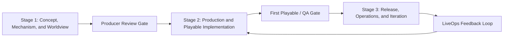
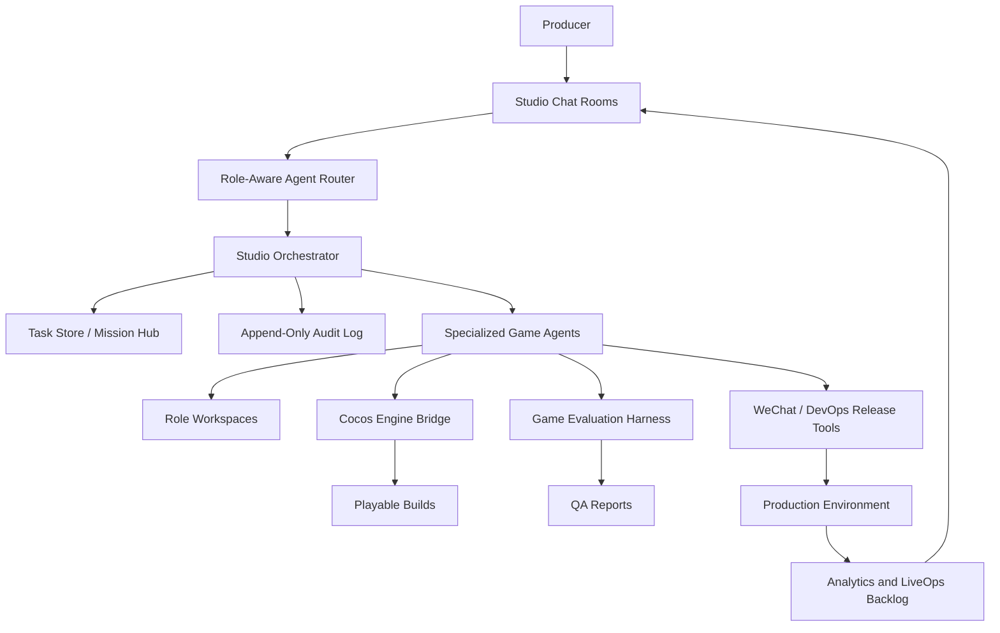

# Game Pipeline Agents

**English** | [简体中文](./README_zh.md)

Game Pipeline Agents is an AI-powered virtual game studio product system and implementation workspace. The system takes a producer's initial game idea plus controlled server access, then coordinates specialized agents across planning, art, engineering, QA, release, and live operations to deliver a production-ready WeChat mini-game.

The initial product scope is lightweight WeChat mini-games built with Cocos Creator, not large-scale PC or console games.

## Product Goal

The final user experience is:

1. The producer provides a game idea, even if the idea is still vague.
2. The system opens a multi-agent studio room where planning and art agents clarify the concept with the producer.
3. Agents generate and maintain game design, art direction, task plans, source code, assets, tests, build logs, deployment records, and iteration plans.
4. At each key production gate, the producer reviews the work and gives feedback.
5. The agents adjust the plan, assets, gameplay, code, tests, and deployment based on the producer's decisions.
6. The system ships a playable WeChat mini-game and keeps the project ready for live-ops iterations.

The producer is not a passive requester. The producer is part of the production process and has continuous authority to ask questions, approve gates, reject deliverables, and redirect the project.

## Core Principle

Game development is visible, traceable, and role-driven.

This system is not a single black-box chatbot that generates a pile of code. It operates as a small game studio where each role has its own responsibility, workspace, deliverables, and accountability trail.

## Target Inputs and Outputs

### Inputs

- Game idea or "ideal" from the producer.
- Optional references such as genre, theme, art style, comparable games, target audience, monetization assumptions, or platform constraints.
- Server or cloud access credentials, stored through a controlled secret mechanism.
- Producer feedback during milestone reviews.

### Outputs

- Game Design Document (GDD).
- Art Bible and asset production plan.
- Runtime-ready 2D assets, UI assets, animations, audio references, and asset manifest.
- Cocos Creator project.
- TypeScript gameplay implementation.
- WeChat mini-game build.
- QA playtest reports, bug reports, screenshots, recordings, and release gate reports.
- Deployment plan, deployment record, rollback plan, and live-ops iteration backlog.

## Multi-Agent Studio Model

The product is organized as a role-based multi-agent studio. Each agent owns a clear part of the pipeline.

| Agent | Main Responsibility | Typical Deliverables |
| --- | --- | --- |
| Studio Orchestrator | Controls workflow state, routing, task creation, phase gates, and cross-agent coordination. | Stage plan, task graph, decision requests, project status. |
| Producer Agent | Converts producer intent into scope, schedule, risks, and milestone reviews. | Roadmap, backlog, risk log, review agenda, decision log. |
| Game Designer Agent | Designs core loop, rules, progression, levels, balance, and player goals. | GDD, core loop spec, level specs, economy and balance specs. |
| Art Director Agent | Defines visual style, UI direction, readability rules, color palette, animation tone, and asset quality bar. | Art Bible, style board, UI visual spec, asset review notes. |
| Asset Production Agent | Produces, normalizes, packages, and version-controls game assets. | Sprites, UI assets, sprite sheets, animation strips, asset manifest. |
| Cocos Tech Lead Agent | Owns Cocos architecture, scene structure, prefab strategy, asset loading, performance budget, and technical standards. | Technical design, scene blueprint, module plan, performance checklist. |
| Gameplay Programmer Agent | Implements game systems, UI logic, gameplay rules, data loading, and integration code. | TypeScript code, Cocos components, implementation notes, code change log. |
| Cocos Automation Agent | Operates Cocos through an engine bridge or MCP layer. | Scene operations, prefab updates, asset imports, build logs, editor snapshots. |
| Game Evaluator / QA Agent | Evaluates the actual game experience, not only unit tests. | Playtest reports, visual QA, bug reports, release gate assessment. |
| WeChat Platform Agent | Handles WeChat mini-game packaging, platform constraints, preview, upload, and platform readiness. | WeChat build config, preview package, upload report, package-size report. |
| DevOps Agent | Handles server deployment, environment setup, logs, rollback, and production readiness. | Deployment plan, release record, rollback plan, server health report. |
| LiveOps / Analytics Agent | Tracks post-release data and plans continuous improvement. | Analytics plan, event schema, iteration backlog, tuning plans. |

## Human-in-the-Loop Production

The producer is involved at key points. The system explicitly requests decisions instead of silently making product-defining choices.

Examples of required producer review points:

- Game concept confirmation.
- Core gameplay and scope approval.
- Art direction approval.
- First playable review.
- Content and difficulty review.
- QA release gate review.
- Production deployment approval.
- Post-release iteration priority review.

Producer feedback is first-class project data. Every accepted or rejected decision is saved with timestamp, requester, affected artifacts, and follow-up tasks.

## Studio Chat Rooms

The collaboration space is a studio group chat with role-aware routing.

Studio rooms:

| Room | Purpose |
| --- | --- |
| `#studio-main` | Main producer room, milestone status, decision requests, and cross-role summaries. |
| `#design-room` | Game rules, GDD, levels, progression, balance, and product discussions. |
| `#art-room` | Art direction, asset list, production status, and asset reviews. |
| `#engineering-room` | Cocos architecture, gameplay code, scene integration, and build issues. |
| `#qa-room` | Playtests, bugs, reproduction steps, recordings, screenshots, and release gates. |
| `#release-room` | WeChat build, server deployment, rollback, logs, and production readiness. |

When the producer asks a question in a room, each agent decides whether the question concerns its role. Relevant agents must respond. Irrelevant agents stay silent unless the Orchestrator asks for a summary.

### Message Types

Messages use structured types so the system can route, index, audit, and visualize work.

- `plan_submission`
- `decision_request`
- `decision_record`
- `progress_update`
- `deliverable`
- `review`
- `change_request`
- `asset_review`
- `bug_report`
- `qa_failure`
- `playtest_summary`
- `build_failure`
- `release_gate`
- `deployment_record`
- `blocker`
- `handoff`

## Three-Stage Production Pipeline



### Stage 1: Concept, Mechanism, and Worldview

This stage handles the early ambiguity of the producer's idea. The producer may only provide a vague direction, so the system must guide the conversation.

Primary agents:

- Game Designer Agent.
- Producer Agent.
- Art Director Agent, lightly involved.
- Studio Orchestrator.

Main tasks:

- Clarify target platform and player session length.
- Define genre, core loop, win and fail conditions.
- Define player fantasy, theme, worldview, and tone.
- Create initial GDD.
- Create early art direction and reference board.
- Define scope for the first playable.
- Request producer approval before development starts.

Exit criteria:

- Approved core loop.
- Approved project scope.
- Approved first version of the GDD.
- Approved art direction.
- Initial backlog and milestone plan.

### Stage 2: Production and Playable Implementation

This stage turns the approved concept into a playable Cocos mini-game. Art starts early, while engineering and QA work in parallel.

Primary agents:

- Art Director Agent.
- Asset Production Agent.
- Cocos Tech Lead Agent.
- Gameplay Programmer Agent.
- Cocos Automation Agent.
- Game Evaluator / QA Agent.
- Producer Agent.

Main tasks:

- Produce and normalize art assets.
- Import assets into Cocos.
- Implement gameplay logic and UI.
- Build scenes and prefabs through a controlled Cocos engine bridge.
- Run automated smoke checks.
- Run playtest evaluation.
- Fix gameplay, visual, and integration issues.
- Prepare first playable review for the producer.

Exit criteria:

- Playable core loop.
- No critical runtime errors.
- Art assets integrated and traceable.
- QA report completed.
- Producer accepts the first playable or submits change requests.

### Stage 3: Release, Operations, and Continuous Iteration

This stage prepares the game for production and keeps it ready for later improvement.

Primary agents:

- Producer Agent.
- Game Designer Agent.
- Gameplay Programmer Agent.
- Game Evaluator / QA Agent.
- WeChat Platform Agent.
- DevOps Agent.
- LiveOps / Analytics Agent.

Main tasks:

- Build WeChat mini-game package.
- Check platform constraints such as package size, loading behavior, and resource strategy.
- Deploy backend or static resources when needed.
- Store release notes and rollback plan.
- Run production readiness gate.
- Publish or prepare upload package.
- Collect analytics and feedback after release.
- Convert feedback into an iteration backlog.

Exit criteria:

- Release build generated.
- Deployment record completed.
- Rollback plan exists.
- Release gate report passed or explicitly waived by the producer.
- LiveOps iteration backlog created.

## Role Workspaces

Each agent keeps its own workspace. This gives the producer and maintainers a white-box view of the full development process.

Project layout:

```text
/studio/projects/{game_id}/
  shared/
    decisions/
    milestones/
    build-artifacts/
    release-notes/

  agents/
    producer/
      backlog.md
      sprint-plan.md
      risk-log.md
      decision-log.md

    design/
      gdd/
      core-loop.md
      level-specs/
      balance-specs/
      change-requests/

    art/
      art-bible.md
      asset-specs/
      raw-assets/
      processed-assets/
      sprite-sheets/
      asset-manifest.json
      review-notes.md

    engineering/
      tech-spec.md
      cocos-scene-blueprints/
      implementation-notes/
      code-change-log.md

    cocos-automation/
      scene-ops/
      prefab-ops/
      editor-snapshots/
      cocos-build-logs/

    qa/
      test-plans/
      playtest-reports/
      screenshots/
      recordings/
      bug-reports/
      release-gate-reports/

    devops/
      deploy-plans/
      server-logs-redacted/
      rollback-plans/
      deployment-reports/
```

## White-Box Traceability

Every important action is written to an append-only audit log.

Audit event schema:

```json
{
  "event_id": "evt_...",
  "timestamp": "2026-07-15T00:00:00Z",
  "project_id": "game_...",
  "stage_id": "stage_2",
  "agent_id": "qa_agent",
  "task_id": "task_...",
  "action_type": "playtest_summary",
  "input_artifacts": ["gdd/core-loop.md", "builds/wechat/dev"],
  "output_artifacts": ["agents/qa/playtest-reports/report-001.md"],
  "tool_calls": ["browser_playtest", "screenshot_capture"],
  "git_commit_or_patch": "abc1234",
  "decision_refs": ["decision-004"],
  "status": "completed",
  "failure_reason": null
}
```

Traceability requirements:

- Art assets must be saved under the art workspace with source, generated version, processed version, and manifest entry.
- QA must save test plans, playtest results, screenshots, recordings, and bug reports.
- Engineering changes must be connected to tasks, commits, or patches.
- Deployment actions must save logs with secrets redacted.
- Producer decisions must be linked to the artifacts and tasks they affect.

## Cocos and WeChat Mini-Game Integration

The engine layer is not a loose collection of generated files. It is a controlled bridge between agents and Cocos Creator.

Engine integration contract:

- Cocos Creator 3.8 LTS is the target engine.
- TypeScript is the gameplay implementation language.
- Scenes and prefabs are represented through structured intermediate files such as `SceneBlueprint.json`.
- The Cocos Automation Agent applies blueprints through an engine bridge or MCP server.
- Complex `.scene` and `.prefab` serialized files are updated through controlled tools.
- Command-line build automation produces WeChat mini-game packages.
- Build logs and editor operation logs are stored in the Cocos automation workspace.

Engine bridge capabilities:

- Open or validate a Cocos project.
- Import and index assets.
- Query scene graph.
- Apply scene blueprint.
- Create or update prefabs.
- Generate and compile scripts.
- Run Cocos build.
- Export WeChat mini-game package.
- Capture editor or runtime snapshots.

## Evaluation and Release Gates

The QA agent represents game product evaluation, not only test execution.

The internal benchmark is `Cocos MiniGame Bench`, because there is no mature public benchmark that fully covers Cocos Creator, WeChat mini-games, multi-agent production, assets, gameplay, and deployment.

Evaluation dimensions:

| Dimension | What It Measures |
| --- | --- |
| Artifact Completeness | Whether all required game, art, QA, and release artifacts exist. |
| Build Health | Whether the Cocos and WeChat builds succeed reliably. |
| Runtime Playability | Whether the game can be launched, played, restarted, and completed. |
| Gameplay Correctness | Whether the implementation matches the approved GDD. |
| Visual Usability | Whether the game is readable, responsive, and visually coherent. |
| Art Consistency | Whether produced assets match the Art Bible. |
| Intent Alignment | Whether the result matches the producer's idea and approved decisions. |
| WeChat Readiness | Whether package size, resource loading, and platform constraints are acceptable. |
| Performance | FPS, memory, loading time, package size, and runtime stability. |
| Security and Ops | Secrets handling, deployment logs, rollback plan, and production observability. |

Benchmark references tracked by the project:

- GameDevBench.
- GameCraft-Bench.
- OpenGame.
- PlayCoder.

## Security Model

Server access is collected at project start for end-to-end delivery, but raw credentials are not exposed to every agent.

Security rules:

- Store credentials in a secret vault.
- Agents request operations through controlled tools instead of reading raw secrets.
- DevOps and release tools receive only the minimum required permission.
- Logs must redact passwords, tokens, private keys, and server addresses when needed.
- Every secret write or deployment action must be audited.

## Reference Architecture



## Implementation Direction

The first implementation focuses on a small but complete vertical slice:

1. Multi-agent studio chat with role-aware routing.
2. Project and phase state machine.
3. Role workspaces and artifact registry.
4. GDD and Art Bible generation workflow.
5. Cocos project generation and asset import bridge.
6. First playable build for WeChat mini-game.
7. QA playtest report and release gate.
8. DevOps deployment record and rollback plan.

The architecture uses Clowder-style multi-agent rooms, agent registries, message routing, invocation queues, task stores, MCP callback tools, workspace explorers, and append-only audit logs as collaboration primitives. The game-specific layer adds production phases, game roles, Cocos automation, asset pipelines, playtest evaluation, and WeChat release gates.

## Roadmap

### V0: Product Skeleton

- Create repository structure.
- Define agent roles and message schema.
- Define project, stage, task, artifact, and audit data models.
- Build basic README and architecture documentation.

### V1: Studio Chat and Planning Flow

- Implement producer-facing studio room.
- Implement role-aware routing.
- Implement Stage 1 concept discussion.
- Generate GDD, Art Bible, backlog, and decision log.

### V2: Cocos First Playable Flow

- Generate Cocos Creator project template.
- Implement structured scene blueprint.
- Add asset production and asset manifest.
- Implement simple playable WeChat mini-game.
- Generate QA playtest report.

### V3: Release and LiveOps Flow

- Automate WeChat build.
- Add deployment workflow.
- Add secret handling and redacted logs.
- Add release gate report.
- Add analytics and iteration backlog.

## Current Status

This repository contains the product specification for Game Pipeline Agents. Implementation starts with executable project scaffolding, data models, and the first studio chat workflow.
