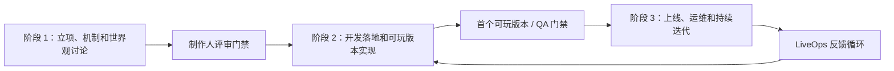
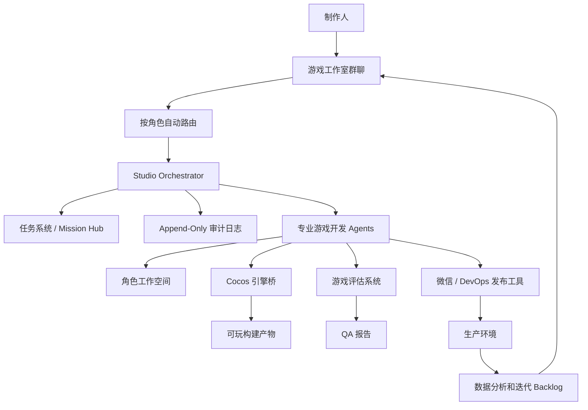

# Game Pipeline Agents

[English](./README.md) | **简体中文**

Game Pipeline Agents 是一个面向“AI 虚拟游戏工作室”的正式产品系统和实现工作区。它的目标是：用户只需要输入一个游戏 idea/ideal，并提供受控的服务器访问权限，系统就能组织策划、美术、程序、测试、发布、运维等多个角色 Agent，端到端交付一个产品级微信小游戏，并支持持续迭代。

初始产品范围聚焦轻量级微信小游戏，游戏引擎使用 Cocos Creator，不覆盖大型游戏、PC 游戏或主机游戏。

## 产品目标

最终用户体验如下：

1. 制作人输入一个游戏 idea，即使这个想法一开始还比较模糊也可以。
2. 系统打开一个多 Agent 游戏工作室群聊空间，由策划和美术先参与开局讨论，帮助制作人把想法澄清成可执行方案。
3. 各个 Agent 生成并维护游戏设计、美术规范、任务计划、源码、资产、测试报告、构建记录、部署记录和迭代计划。
4. 在关键节点，制作人审视游戏作品并给出意见。
5. 各个游戏开发 Agent 根据制作人的意见调整玩法、资产、代码、测试和发布计划。
6. 系统最终交付一个可玩的微信小游戏，并保留后续持续运营和版本迭代能力。

制作人不是一个只在开头输入需求、最后等待结果的旁观者。制作人像真实游戏项目里的制作人一样，拥有随时询问进度、审批节点、否决方案、提出修改意见的权限，并且这些意见会进入项目记录和任务流。

## 核心原则

游戏开发过程必须是可见、可追溯、角色职责清晰的。

这个系统不是一个黑盒聊天机器人，也不是一次性生成一堆代码的工具。它以小型游戏工作室的方式运行：每个角色都有明确职责、独立工作空间、标准产物和责任留痕。

## 输入与输出

### 输入

- 制作人提供的游戏 idea/ideal。
- 可选参考信息，例如品类、题材、美术风格、对标游戏、目标玩家、商业化假设、平台约束。
- 服务器或云服务访问权限，必须通过受控密钥机制保存。
- 制作人在各个里程碑节点给出的审阅意见。

### 输出

- 游戏设计文档 GDD。
- 美术风格文档 Art Bible 和资产生产计划。
- 可运行的 2D 资产、UI 资产、动画、音效引用和资产清单。
- Cocos Creator 工程。
- TypeScript 玩法实现。
- 微信小游戏构建产物。
- QA 试玩报告、问题报告、截图、录屏和发布门禁报告。
- 部署方案、部署记录、回滚方案和后续 LiveOps 迭代 backlog。

## 多 Agent 游戏工作室模型

产品采用角色化多 Agent 工作室模型。每个 Agent 都拥有清晰的职责边界。

| Agent | 主要职责 | 典型产物 |
| --- | --- | --- |
| Studio Orchestrator | 控制工作流状态、消息路由、任务拆解、阶段门禁和跨 Agent 协作。 | 阶段计划、任务图、决策请求、项目状态。 |
| Producer Agent | 把制作人的意图转化为范围、排期、风险和里程碑评审。 | 路线图、backlog、风险日志、评审议程、决策日志。 |
| Game Designer Agent | 设计核心循环、规则、成长、关卡、数值和平衡。 | GDD、核心循环说明、关卡规格、数值规格。 |
| Art Director Agent | 定义美术风格、UI 方向、可读性规则、色板、动画语气和资产质量标准。 | Art Bible、风格板、UI 视觉规范、资产评审记录。 |
| Asset Production Agent | 生产、清洗、规格化、打包和版本化游戏资产。 | 精灵图、UI 资产、sprite sheet、动画序列、asset manifest。 |
| Cocos Tech Lead Agent | 负责 Cocos 架构、场景结构、Prefab 策略、资源加载、性能预算和技术规范。 | 技术方案、场景蓝图、模块计划、性能检查清单。 |
| Gameplay Programmer Agent | 实现游戏系统、UI 逻辑、玩法规则、数据加载和集成代码。 | TypeScript 代码、Cocos 组件、实现说明、代码变更日志。 |
| Cocos Automation Agent | 通过引擎桥或 MCP 工具操作 Cocos。 | 场景操作记录、Prefab 更新记录、资源导入记录、构建日志、编辑器快照。 |
| Game Evaluator / QA Agent | 负责游戏作品评估，不只是执行单元测试。 | 试玩报告、视觉 QA、Bug 报告、发布门禁评估。 |
| WeChat Platform Agent | 负责微信小游戏打包、平台约束、预览、上传和平台适配。 | 微信构建配置、预览包、上传报告、包体体积报告。 |
| DevOps Agent | 负责服务器部署、环境配置、日志、回滚和生产就绪性。 | 部署方案、发布记录、回滚方案、服务器健康报告。 |
| LiveOps / Analytics Agent | 负责上线后的数据观察和持续迭代计划。 | 埋点方案、事件结构、迭代 backlog、调优方案。 |

## Human-in-the-Loop 制作流程

制作人必须参与关键节点。系统显式请求制作人决策，不默默替制作人做影响产品方向的决定。

需要制作人参与的典型节点：

- 游戏概念确认。
- 核心玩法和范围审批。
- 美术方向审批。
- 首个可玩版本审阅。
- 内容和难度审阅。
- QA 发布门禁审阅。
- 生产环境部署审批。
- 上线后迭代优先级审阅。

制作人的意见是项目的一等数据。每一个被接受或拒绝的决策都保存时间、发起人、影响产物和后续任务。

## 游戏工作室群聊空间

协作空间是一个游戏工作室群聊，并且具备按角色自动路由的能力。

房间结构：

| 房间 | 用途 |
| --- | --- |
| `#studio-main` | 制作人主房间、里程碑状态、决策请求和跨角色总结。 |
| `#design-room` | 玩法规则、GDD、关卡、成长、数值和平衡讨论。 |
| `#art-room` | 美术方向、资产清单、生产进度和资产评审。 |
| `#engineering-room` | Cocos 架构、玩法代码、场景集成和构建问题。 |
| `#qa-room` | 试玩、Bug、复现步骤、录屏、截图和发布门禁。 |
| `#release-room` | 微信构建、服务器部署、回滚、日志和生产就绪性。 |

当制作人在某个房间提问时，每个 Agent 自动判断这个问题是否与自己的职责相关。相关 Agent 必须回复；无关 Agent 默认保持静默，除非 Orchestrator 要求汇总。

### 消息类型

消息具有结构化类型，方便系统做路由、索引、审计和可视化。

- `plan_submission`：方案提交。
- `decision_request`：请求制作人决策。
- `decision_record`：决策记录。
- `progress_update`：进度更新。
- `deliverable`：产物提交。
- `review`：评审意见。
- `change_request`：变更请求。
- `asset_review`：资产评审。
- `bug_report`：Bug 报告。
- `qa_failure`：测试失败。
- `playtest_summary`：试玩总结。
- `build_failure`：构建失败。
- `release_gate`：发布门禁。
- `deployment_record`：部署记录。
- `blocker`：阻塞问题。
- `handoff`：角色间交接。

## 三阶段游戏生产流水线



### 阶段 1：立项、机制和世界观讨论

这个阶段解决制作人 idea 一开始不清晰的问题。制作人可以只给一个模糊方向，系统需要通过对话把方向变成可执行的游戏方案。

主要参与角色：

- Game Designer Agent。
- Producer Agent。
- Art Director Agent，轻度参与。
- Studio Orchestrator。

主要任务：

- 澄清目标平台和单局时长。
- 定义品类、核心循环、胜利条件和失败条件。
- 定义玩家幻想、题材、世界观和整体语气。
- 创建初版 GDD。
- 创建早期美术方向和参考板。
- 定义首个可玩版本范围。
- 在进入开发前请求制作人审批。

退出标准：

- 核心循环已审批。
- 项目范围已审批。
- 初版 GDD 已审批。
- 美术方向已审批。
- 初始 backlog 和里程碑计划已生成。

### 阶段 2：开发落地和可玩版本实现

这个阶段把审批后的方案变成可玩的 Cocos 微信小游戏。美术先启动，程序和 QA 同步穿插进行。

主要参与角色：

- Art Director Agent。
- Asset Production Agent。
- Cocos Tech Lead Agent。
- Gameplay Programmer Agent。
- Cocos Automation Agent。
- Game Evaluator / QA Agent。
- Producer Agent。

主要任务：

- 生产并规格化美术资产。
- 将资产导入 Cocos。
- 实现玩法逻辑和 UI。
- 通过受控 Cocos 引擎桥创建场景和 Prefab。
- 执行自动化冒烟检查。
- 执行试玩评估。
- 修复玩法、视觉和集成问题。
- 准备首个可玩版本给制作人审阅。

退出标准：

- 核心循环可玩。
- 没有关键运行时错误。
- 美术资产已集成并可追溯。
- QA 报告已完成。
- 制作人接受首个可玩版本，或提交明确变更请求。

### 阶段 3：上线、运维和持续迭代

这个阶段负责生产环境交付，并为后续优化保留持续迭代能力。

主要参与角色：

- Producer Agent。
- Game Designer Agent。
- Gameplay Programmer Agent。
- Game Evaluator / QA Agent。
- WeChat Platform Agent。
- DevOps Agent。
- LiveOps / Analytics Agent。

主要任务：

- 构建微信小游戏包。
- 检查包体、加载方式、资源策略等微信平台约束。
- 在需要时部署后端或静态资源。
- 保存发布说明和回滚方案。
- 执行生产就绪门禁。
- 发布或准备上传包。
- 上线后收集数据和反馈。
- 将反馈转化为后续版本迭代 backlog。

退出标准：

- 发布构建产物已生成。
- 部署记录已完成。
- 回滚方案存在。
- 发布门禁报告通过，或由制作人显式豁免。
- LiveOps 迭代 backlog 已生成。

## 角色工作空间

每个 Agent 都有自己的工作空间。这样制作人和维护者可以白盒地观察完整游戏开发过程。

项目目录：

```text
/studio/projects/{game_id}/
  shared/
    decisions/
    milestones/
    build-artifacts/
    release-notes/

  agents/
    producer/
      backlog.md
      sprint-plan.md
      risk-log.md
      decision-log.md

    design/
      gdd/
      core-loop.md
      level-specs/
      balance-specs/
      change-requests/

    art/
      art-bible.md
      asset-specs/
      raw-assets/
      processed-assets/
      sprite-sheets/
      asset-manifest.json
      review-notes.md

    engineering/
      tech-spec.md
      cocos-scene-blueprints/
      implementation-notes/
      code-change-log.md

    cocos-automation/
      scene-ops/
      prefab-ops/
      editor-snapshots/
      cocos-build-logs/

    qa/
      test-plans/
      playtest-reports/
      screenshots/
      recordings/
      bug-reports/
      release-gate-reports/

    devops/
      deploy-plans/
      server-logs-redacted/
      rollback-plans/
      deployment-reports/
```

## 白盒留痕与可追溯性

所有关键行为都写入 append-only 审计日志。

审计事件结构：

```json
{
  "event_id": "evt_...",
  "timestamp": "2026-07-15T00:00:00Z",
  "project_id": "game_...",
  "stage_id": "stage_2",
  "agent_id": "qa_agent",
  "task_id": "task_...",
  "action_type": "playtest_summary",
  "input_artifacts": ["gdd/core-loop.md", "builds/wechat/dev"],
  "output_artifacts": ["agents/qa/playtest-reports/report-001.md"],
  "tool_calls": ["browser_playtest", "screenshot_capture"],
  "git_commit_or_patch": "abc1234",
  "decision_refs": ["decision-004"],
  "status": "completed",
  "failure_reason": null
}
```

可追溯性要求：

- 美术资产必须保存在美术工作空间，并记录来源、生成版本、处理版本和 manifest 条目。
- QA 必须保存测试计划、试玩结果、截图、录屏和 Bug 报告。
- 程序改动必须关联任务、commit 或 patch。
- 部署动作必须保存日志，并对敏感信息脱敏。
- 制作人决策必须关联受影响的产物和任务。

## Cocos 与微信小游戏集成

引擎层不是散落的生成文件，而是 Agent 和 Cocos Creator 之间的受控桥接层。

引擎集成契约：

- 目标引擎使用 Cocos Creator 3.8 LTS。
- 玩法实现语言使用 TypeScript。
- 场景和 Prefab 通过结构化中间文件表达，例如 `SceneBlueprint.json`。
- Cocos Automation Agent 通过引擎桥或 MCP Server 应用场景蓝图。
- 复杂的 `.scene` 和 `.prefab` 序列化文件通过受控工具更新。
- 微信小游戏包通过命令行自动化构建。
- Cocos 自动化工作空间保存构建日志和编辑器操作日志。

引擎桥能力：

- 打开或校验 Cocos 项目。
- 导入并索引资产。
- 查询场景树。
- 应用场景蓝图。
- 创建或更新 Prefab。
- 生成并编译脚本。
- 执行 Cocos 构建。
- 导出微信小游戏包。
- 捕获编辑器或运行时快照。

## 评估体系与发布门禁

测试 Agent 代表的是游戏作品评估流程，不只是跑单元测试。

内部评估基准是 `Cocos MiniGame Bench`，因为目前没有一个成熟公开 benchmark 能完整覆盖 Cocos Creator、微信小游戏、多 Agent 生产、美术资产、玩法体验和部署交付。

评估维度：

| 维度 | 衡量内容 |
| --- | --- |
| Artifact Completeness | 游戏、美术、QA、发布相关产物是否齐全。 |
| Build Health | Cocos 和微信小游戏构建是否稳定成功。 |
| Runtime Playability | 游戏是否能启动、游玩、重开和完成核心流程。 |
| Gameplay Correctness | 实现是否符合已审批 GDD。 |
| Visual Usability | 画面是否清晰、反馈是否明确、交互是否可读。 |
| Art Consistency | 资产是否符合 Art Bible。 |
| Intent Alignment | 成品是否符合制作人 idea 和历史决策。 |
| WeChat Readiness | 包体、资源加载和平台约束是否可接受。 |
| Performance | FPS、内存、加载时间、包体大小和运行稳定性。 |
| Security and Ops | 密钥处理、部署日志、回滚方案和生产可观测性。 |

项目跟踪的 benchmark：

- GameDevBench。
- GameCraft-Bench。
- OpenGame。
- PlayCoder。

## 安全模型

为了端到端交付，服务器访问权限在项目开始时收集，但原始凭据不暴露给所有 Agent。

安全规则：

- 凭据进入 Secret Vault。
- Agent 通过受控工具请求操作，而不是直接读取明文密钥。
- DevOps 和发布工具只获得最小必要权限。
- 日志必须对密码、token、私钥和必要的服务器地址做脱敏。
- 每一次密钥写入或部署动作都必须进入审计日志。

## 系统架构



## 实现方向

第一版实现聚焦一个小而完整的 vertical slice：

1. 多 Agent 游戏工作室群聊和按角色路由。
2. 项目和阶段状态机。
3. 角色工作空间和产物注册表。
4. GDD 和 Art Bible 生成流程。
5. Cocos 工程生成和资产导入桥。
6. 微信小游戏首个可玩版本。
7. QA 试玩报告和发布门禁。
8. DevOps 部署记录和回滚方案。

整体架构使用 Clowder 一类多 Agent 聊天室系统里的房间、Agent Registry、消息路由、Invocation Queue、Task Store、MCP Callback、Workspace Explorer 和 Append-Only Audit Log 作为协作基础。游戏领域层补充三阶段生产流程、游戏开发角色、美术资产流水线、Cocos 自动化、试玩评估和微信小游戏发布门禁。

## 路线图

### V0：产品骨架

- 创建仓库结构。
- 定义 Agent 角色和消息 schema。
- 定义项目、阶段、任务、产物和审计数据模型。
- 建立 README 和架构文档。

### V1：工作室群聊和策划流程

- 实现制作人主工作室房间。
- 实现按角色自动路由。
- 实现阶段 1 的立项讨论流程。
- 生成 GDD、Art Bible、backlog 和决策日志。

### V2：Cocos 首个可玩版本流程

- 生成 Cocos Creator 项目模板。
- 实现结构化场景蓝图。
- 增加资产生产和 asset manifest。
- 实现一个简单可玩的微信小游戏。
- 生成 QA 试玩报告。

### V3：发布和 LiveOps 流程

- 自动化微信小游戏构建。
- 增加部署流程。
- 增加密钥处理和日志脱敏。
- 增加发布门禁报告。
- 增加数据分析和迭代 backlog。

## 当前状态

当前仓库包含 Game Pipeline Agents 的产品规格。实现从可执行项目骨架、数据模型和第一个游戏工作室群聊流程开始。
