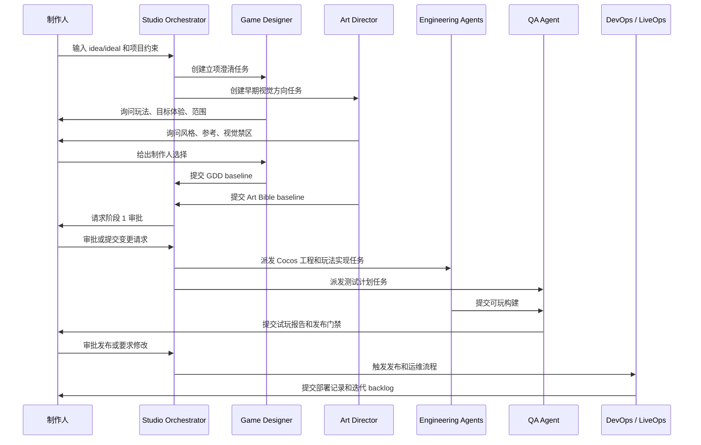

# 01. 产品范围与用户旅程

## 1. 产品定位

Game Pipeline Agents 是一个面向微信小游戏交付的多 Agent 游戏工作室系统。系统接收制作人的游戏 idea/ideal 和受控服务器访问权限，组织策划、美术、程序、QA、发布、运维等角色 Agent，完成从立项讨论到 Cocos 工程实现、微信小游戏构建、发布准备和持续迭代的完整生产流程。

系统的首要产品形态是“制作人参与的游戏工作室群聊”，不是一次性 Prompt 到代码生成器。制作人通过工作室房间持续参与决策、审阅、否决和变更，Agent 通过结构化消息、角色工作空间、生产记忆和审计日志形成可追溯的白盒生产过程。

## 2. 产品边界

系统覆盖：

- 微信小游戏。
- Cocos Creator 3.8 LTS。
- 2D 轻量级游戏。
- 单项目从 idea 到可玩构建的完整交付。
- 后续迭代、运维、数据反馈和版本优化。

系统不覆盖：

- 大型 PC、主机或 AAA 项目。
- 完全无人参与的自动立项和自动上线。
- 不经制作人审批的产品方向变更。
- 直接暴露服务器密码、模型 API key 或私钥给 Agent。

## 3. 目标用户

核心用户是制作人。制作人负责：

- 提供初始 idea/ideal。
- 提供项目约束，例如题材、玩法、单局时长、目标用户、商业化方向、参考游戏。
- 在关键节点审批或否决 Agent 产物。
- 在群聊中随时询问进度。
- 作为最终产品方向的裁决者。

## 4. 输入

| 输入 | 类型 | 处理方式 |
| --- | --- | --- |
| 游戏 idea/ideal | 自然语言 | 进入阶段 1，由策划 Agent 主导澄清。 |
| 参考游戏或素材 | 链接、图片、文本 | 存入项目参考资料，生成 Art Bible 和 GDD 时引用。 |
| 服务器访问权限 | 密钥、IP、用户名、密码、token | 进入 Secret Vault，不进入 Agent 记忆和审计明文。 |
| 制作人反馈 | 群聊消息、审批、否决、变更请求 | 进入 Decision Memory、Task Store 和 Audit Log。 |
| 平台约束 | 微信小游戏、包体、性能、网络 | 进入技术规格和发布门禁。 |

## 5. 输出

| 输出 | 所属角色 | 存储位置 |
| --- | --- | --- |
| GDD | Game Designer Agent | `agents/design/gdd/` |
| Art Bible | Art Director Agent | `agents/art/art-bible.md` |
| 资产规格和资产清单 | Art Director / Asset Production | `agents/art/asset-specs/`, `agents/art/asset-manifest.json` |
| Cocos 工程 | Cocos Automation / Engineering | `workspace/game-project/` |
| TypeScript 玩法代码 | Gameplay Programmer Agent | Cocos 工程源码目录 |
| QA 试玩报告 | Game Evaluator / QA Agent | `agents/qa/playtest-reports/` |
| Bug 报告和复现材料 | Game Evaluator / QA Agent | `agents/qa/bug-reports/`, `agents/qa/screenshots/`, `agents/qa/recordings/` |
| 微信小游戏构建产物 | WeChat Platform Agent | `shared/build-artifacts/` |
| 部署记录和回滚方案 | DevOps Agent | `agents/devops/deployment-reports/`, `agents/devops/rollback-plans/` |
| 迭代 backlog | LiveOps / Analytics Agent | `shared/release-notes/`, `agents/producer/backlog.md` |

## 6. 端到端用户旅程

## 7. 阶段视图

系统在工作室首页展示三个阶段：

| 阶段 | 主导角色 | 关键产物 | 制作人动作 |
| --- | --- | --- | --- |
| 立项、机制和世界观讨论 | Game Designer, Producer, Art Director | GDD baseline, Art Bible baseline, 里程碑计划 | 审批核心玩法、范围和美术方向 |
| 开发落地和可玩版本实现 | Art, Engineering, Cocos Automation, QA | 资产、Cocos 工程、可玩构建、QA 报告 | 试玩、反馈、接受或变更 |
| 上线、运维和持续迭代 | Producer, QA, WeChat, DevOps, LiveOps | 发布包、部署记录、回滚方案、迭代 backlog | 审批发布和后续优先级 |

## 8. 开局澄清流程

当制作人输入模糊 idea 时，系统不直接进入开发。Stage 1 的目标是把模糊想法变成可执行的产品约束。

策划 Agent 负责澄清：

- 游戏品类。
- 单局时长。
- 核心操作。
- 胜负条件。
- 玩家成长。
- 目标情绪。
- 第一可玩范围。

美术 Agent 轻度参与，负责澄清：

- 视觉风格。
- 参考游戏或图片。
- 目标用户审美。
- 色彩方向。
- UI 可读性要求。
- 禁止出现的风格或元素。

每一轮澄清结果写入 Decision Memory，未确认内容保持 `draft`，制作人确认后转为 `active`。

## 9. 制作人关键节点

制作人参与节点：

- 立项问题澄清。
- 核心循环审批。
- Art Bible 审批。
- 首个可玩构建审阅。
- QA 发布门禁审阅。
- 微信小游戏构建和部署审批。
- 上线后迭代优先级审批。

所有审批和否决都生成 `decision_record` 消息、Decision Memory 和 AuditEvent。

## 10. 产品成功标准

系统完成一次项目交付时满足：

- 微信小游戏构建可运行。
- Cocos 工程和源码可追溯。
- GDD、Art Bible、资产清单、QA 报告、发布记录齐全。
- 关键决策均有关联制作人审批记录。
- Agent 工作区保留角色产物。
- 密钥未进入日志和记忆明文。
- QA 门禁通过，或制作人显式豁免。
- LiveOps backlog 存在，可继续迭代。
