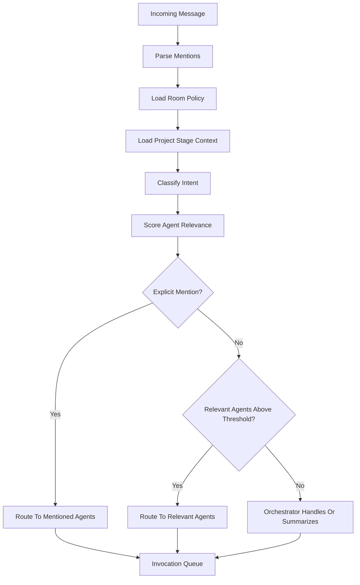

# 03. 多 Agent 群聊与消息路由

## 1. 群聊系统定位

群聊系统是制作人与 Agent 协作的主界面。它承载讨论、决策、交接、进度询问、产物提交、评审和发布门禁。每条消息都进入 Message Store，关键消息同步写入 Memory、Task Store、Artifact Registry 或 Audit Log。

## 2. 房间模型

| 房间 | 主用途 | 默认参与 Agent |
| --- | --- | --- |
| `#studio-main` | 制作人主房间、阶段状态、决策请求、总览汇报。 | Orchestrator, Producer, Designer, Art, QA |
| `#design-room` | GDD、核心循环、机制、数值、关卡。 | Designer, Producer, QA |
| `#art-room` | Art Bible、资产规格、资产生产、视觉评审。 | Art Director, Asset Production, QA |
| `#engineering-room` | Cocos 架构、代码、场景、构建。 | Cocos Tech Lead, Gameplay Programmer, Cocos Automation |
| `#qa-room` | 试玩、Bug、截图、录屏、发布门禁。 | QA, Programmer, Art, Producer |
| `#release-room` | 微信构建、部署、回滚、日志、生产状态。 | WeChat Platform, DevOps, QA, LiveOps |

房间是 Thread 的产品化映射。每个房间包含：

- `room_id`
- `project_id`
- `stage_id`
- `participants`
- `routing_policy`
- `memory_context_policy`
- `workspace_scope`

## 3. 消息结构

```json
{
  "message_id": "msg_...",
  "project_id": "game_...",
  "room_id": "design-room",
  "sender_type": "producer",
  "sender_id": "user_...",
  "message_type": "decision_request",
  "content": "请确认核心玩法采用点击防守还是拖拽合成。",
  "mentions": ["game_designer"],
  "related_task_ids": ["task_..."],
  "related_artifact_ids": ["artifact_..."],
  "visibility": "room",
  "created_at": "2026-07-15T00:00:00Z",
  "metadata": {
    "stage": "concept",
    "requires_response": true
  }
}
```

## 4. 消息类型

| 类型 | 说明 | 写入位置 |
| --- | --- | --- |
| `plan_submission` | Agent 提交方案。 | Message Store, Artifact Registry |
| `decision_request` | 请求制作人选择或审批。 | Message Store, Task Store |
| `decision_record` | 制作人决策记录。 | Decision Memory, Audit Log |
| `progress_update` | 进度汇报。 | Role Memory |
| `deliverable` | 产物提交。 | Artifact Registry |
| `review` | 审阅意见。 | Message Store, Decision Memory |
| `change_request` | 制作人变更请求。 | Task Store, Decision Memory |
| `asset_review` | 美术资产评审。 | Artifact Registry, QA Memory |
| `bug_report` | Bug 报告。 | QA Workspace, Task Store |
| `qa_failure` | 测试失败。 | QA Memory, Audit Log |
| `playtest_summary` | 试玩总结。 | QA Memory |
| `build_failure` | 构建失败。 | Engineering Workspace, Audit Log |
| `release_gate` | 发布门禁结论。 | QA Memory, Release Memory |
| `deployment_record` | 部署记录。 | Release Memory, Audit Log |
| `blocker` | 阻塞说明。 | Task Store |
| `handoff` | 角色交接。 | Role Memory, Task Store |

## 5. 路由流程



## 6. 相关性评分

Agent 相关性由以下信号计算：

| 信号 | 权重 |
| --- | --- |
| 显式 @mention | 100 |
| 当前房间是 Agent 主房间 | 30 |
| 消息涉及 Agent 当前任务 | 40 |
| 消息涉及 Agent 产物 | 35 |
| 消息类型属于 Agent 职责 | 30 |
| 当前阶段由 Agent 主导 | 25 |
| 最近 10 条消息中 Agent 是主要参与者 | 10 |
| 制作人询问“进度”且 Agent 有 doing/blocked 任务 | 30 |

路由规则：

- 分数 `>= 60` 必须响应。
- 分数 `40-59` 由 Orchestrator 决定是否唤起。
- 分数 `< 40` 保持静默。

## 7. 制作人随时询问进度

制作人消息示例：

- “现在进度怎么样？”
- “美术这边卡在哪里？”
- “QA 有什么问题？”
- “能不能准备上线？”

处理流程：

1. Orchestrator 判断为 `progress_query`。
2. 查询 Task Store 中 `doing`、`blocked`、`review` 状态任务。
3. 查询 Role Memory 的 `workspace-summary.md`。
4. 唤起相关 Agent。
5. 每个相关 Agent 回复自己的事实状态。
6. Orchestrator 汇总成项目状态卡片。

## 8. 并行与串行

并行适用：

- 开局创意发散。
- 多 Agent 同时汇报进度。
- 美术、程序、QA 对同一构建分别评审。

串行适用：

- 阶段门禁。
- 任务交接。
- 构建失败修复。
- 发布审批。
- A2A handoff。

串行规则：

- 每次 handoff 必须指定 `from_agent`、`to_agent`、`task_id`、`artifact_refs`。
- 被交接 Agent 必须确认接收或说明阻塞。
- Orchestrator 记录交接事件。

## 9. Invocation Queue

每个 `(project_id, room_id, agent_id)` 具有独立执行槽，避免同一 Agent 对同一房间并发写入互相覆盖。

队列字段：

```json
{
  "invocation_id": "inv_...",
  "project_id": "game_...",
  "room_id": "art-room",
  "agent_id": "art_director",
  "source_message_id": "msg_...",
  "priority": 50,
  "status": "queued",
  "idempotency_key": "room:art-room:msg:123:agent:art_director",
  "created_at": "2026-07-15T00:00:00Z"
}
```

## 10. 回复约束

Agent 回复必须：

- 引用任务和产物。
- 说明当前状态。
- 给出下一步。
- 标明阻塞。
- 不编造未完成产物。
- 不暴露 secret。
- 不替制作人做最终决策。

## 11. Clowder 映射

| Clowder 概念 | 本系统映射 |
| --- | --- |
| Thread | Studio Room |
| Cat / Agent Registry | Game Agent Registry |
| @mention Router | Role-aware Router |
| Invocation Queue | Agent Execution Queue |
| Task Store | Task and Mission Hub |
| Workspace Explorer | Role Workspace Explorer |
| MCP Callback | Agent Callback Tools |
| Audit Log | Append-only Production Audit Log |

## 12. 失败处理

失败类型：

- Agent 超时。
- 模型调用失败。
- 工具调用失败。
- 产物写入失败。
- 路由误触发。
- 多 Agent 结论冲突。

处理规则：

- 超时任务进入 `blocked`。
- 模型失败进入 Model Gateway 重试策略。
- 工具失败写入 Audit Log。
- 结论冲突升级给 Producer Agent 或 Studio Orchestrator。
- 涉及产品方向冲突时请求制作人裁决。
