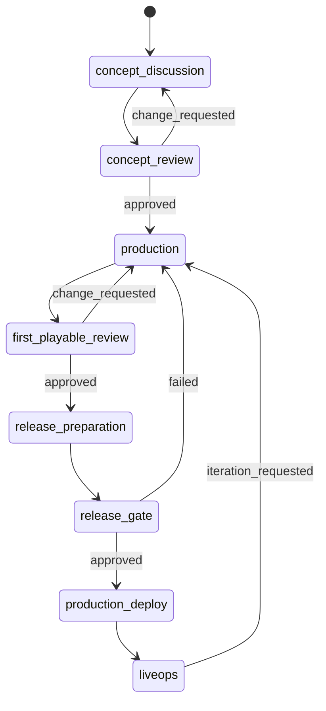

# 04. 工作流编排与阶段门禁

## 1. 编排职责

Workflow Orchestrator 负责把群聊协作转化为可执行生产流程。它不生产具体游戏内容，而是维护阶段状态、任务图、阶段门禁、制作人审批和跨角色交接。

## 2. 项目状态机



## 3. 阶段定义

| 阶段 | 状态值 | 主导角色 | 阶段产物 |
| --- | --- | --- | --- |
| 立项、机制和世界观讨论 | `concept_discussion` | Designer, Producer, Art Director | GDD baseline, Art Bible baseline, Backlog |
| 制作人立项评审 | `concept_review` | Orchestrator, Producer | Decision Record |
| 开发落地 | `production` | Art, Engineering, QA | Assets, Cocos Project, Playable Build |
| 首个可玩评审 | `first_playable_review` | QA, Producer | Playtest Report, Change Requests |
| 发布准备 | `release_preparation` | WeChat, DevOps, QA | Release Build, Deploy Plan |
| 发布门禁 | `release_gate` | QA, Producer | Release Gate Report |
| 生产部署 | `production_deploy` | DevOps, WeChat | Deployment Record, Rollback Plan |
| 持续迭代 | `liveops` | LiveOps, Producer | Analytics Report, Iteration Backlog |

## 4. 阶段门禁结构

```json
{
  "gate_id": "gate_concept_001",
  "project_id": "game_...",
  "stage_id": "concept_review",
  "required_artifacts": [
    "agents/design/gdd/core-loop.md",
    "agents/art/art-bible.md",
    "agents/producer/backlog.md"
  ],
  "checks": [
    "core_loop_approved",
    "scope_approved",
    "art_direction_approved"
  ],
  "status": "pending_producer",
  "decision_id": null
}
```

## 5. 阶段 1：立项、机制和世界观讨论

目标：

- 将模糊 idea 变成可执行游戏方向。
- 输出 GDD baseline。
- 输出 Art Bible baseline。
- 生成第一可玩范围和 backlog。

任务：

- 策划 Agent 发起澄清问题。
- 美术 Agent 发起视觉澄清。
- Producer Agent 控制范围。
- Orchestrator 汇总并创建审批请求。

退出条件：

- 核心玩法已审批。
- 美术方向已审批。
- 第一可玩范围已审批。
- 风险和阻塞已记录。

## 6. 阶段 2：开发落地和可玩版本实现

目标：

- 生产可运行 Cocos 微信小游戏构建。
- 资产、代码、场景、测试同步推进。

任务：

- Art Director 生成资产规格。
- Asset Production 生产并处理资产。
- Cocos Tech Lead 生成技术方案。
- Gameplay Programmer 编写玩法代码。
- Cocos Automation 应用场景蓝图。
- QA 执行冒烟测试和试玩。

退出条件：

- Cocos 构建成功。
- 核心循环可玩。
- 无 critical Bug。
- QA 试玩报告存在。
- 制作人接受或提交变更请求。

## 7. 阶段 3：上线、运维和持续迭代

目标：

- 完成微信小游戏发布准备。
- 完成生产部署和回滚准备。
- 建立上线后迭代闭环。

任务：

- WeChat Platform Agent 生成平台检查报告。
- DevOps Agent 执行部署准备。
- QA Agent 执行发布门禁。
- LiveOps Agent 创建埋点和迭代 backlog。

退出条件：

- 发布构建产物存在。
- 发布门禁通过或制作人豁免。
- 部署记录和回滚方案存在。
- 迭代 backlog 存在。

## 8. 任务生成规则

每个阶段由 Orchestrator 创建任务批次：

```json
{
  "task_id": "task_...",
  "project_id": "game_...",
  "stage_id": "production",
  "owner_agent_id": "gameplay_programmer",
  "title": "实现核心点击防守玩法",
  "status": "todo",
  "acceptance_criteria": [
    "玩家可点击防守目标",
    "敌人按配置生成",
    "胜负条件与 GDD 一致"
  ],
  "input_artifacts": [
    "agents/design/gdd/core-loop.md"
  ],
  "output_artifacts": [
    "workspace/game-project/assets/scripts/CoreLoop.ts"
  ]
}
```

Orchestrator 同时创建大任务和子任务：

```text
task_group: 阶段 2：开发落地和可玩版本实现
  task: 生产核心美术资产
    subtask: 生成玩家角色 sprite
    subtask: 生成敌人 sprite
    subtask: 打包 sprite sheet
  task: 实现核心玩法
    subtask: 实现敌人生成器
    subtask: 实现点击命中判定
    subtask: 实现结算界面
  task: 执行首轮 QA
    subtask: 冒烟测试
    subtask: 试玩录屏
    subtask: 发布门禁初评
```

每个子任务状态更新后，Orchestrator 刷新父任务、大任务和 Workspace Task Board 的状态桶。

## 9. 制作人进度询问

制作人询问“现在进度怎么样”时，Orchestrator 从 Workspace Task Board 读取：

- 大任务总数。
- 子任务总数。
- `进行中 / 阻塞中 / 待办 / 已完成` 数量。
- 当前阻塞任务。
- 各角色当前任务。
- 即将需要制作人审批的节点。

回复结构：

```json
{
  "message_type": "progress_update",
  "project_id": "game_...",
  "summary": "阶段 2 正在进行，13 个子任务中 4 个完成、3 个进行中、1 个阻塞、5 个待办。",
  "buckets": {
    "doing": 3,
    "blocked": 1,
    "todo": 5,
    "done": 4
  },
  "blocked_tasks": ["task_asset_button_palette"],
  "producer_decisions_needed": ["确认按钮主色"]
}
```

## 10. 变更请求处理

制作人可在任意阶段提交 `change_request`。

处理流程：

1. Orchestrator 判断影响范围。
2. Producer Agent 评估范围、时间和风险。
3. 受影响 Agent 给出调整方案。
4. 制作人审批变更。
5. 旧决策标记为 `superseded` 或 `rejected`。
6. 新任务进入 Task Store。

## 11. 阻塞处理

阻塞来源：

- 缺少制作人决策。
- 资产未完成。
- 构建失败。
- 测试失败。
- Secret 权限不足。
- 模型或工具调用失败。

阻塞记录：

```json
{
  "blocker_id": "blk_...",
  "task_id": "task_...",
  "owner_agent_id": "qa_agent",
  "reason": "构建无法启动，缺少主场景配置。",
  "required_action": "Cocos Automation Agent 修复 build config。",
  "status": "open"
}
```

## 12. 阶段回退

回退规则：

- 发布门禁失败回退到 `production`。
- 首个可玩评审不通过回退到 `production`。
- 核心玩法被制作人否决回退到 `concept_discussion`。
- 生产部署失败回退到 `release_preparation`。

回退必须写入 Audit Log，并生成原因说明和修复任务。

## 13. 门禁决策格式

```json
{
  "decision_id": "decision_...",
  "gate_id": "gate_release_001",
  "producer_id": "user_...",
  "verdict": "approved",
  "notes": "同意发布当前构建，QA 中的低优先级 UI 问题进入上线后 backlog。",
  "waived_checks": ["minor_ui_alignment"],
  "created_at": "2026-07-15T00:00:00Z"
}
```

## 14. 幂等性

阶段推进必须幂等：

- 同一个 gate 只能生成一个 active decision。
- 重复点击审批不重复创建发布任务。
- 重试构建不覆盖旧构建日志。
- 任务重开保留历史状态。

## 15. Orchestrator 输出

Orchestrator 在 `#studio-main` 中展示：

- 当前阶段。
- 当前门禁。
- 大任务和子任务状态桶。
- 正在执行任务。
- 阻塞。
- 等待制作人决策。
- 最新构建状态。
- QA 状态。
- 下一步计划。
