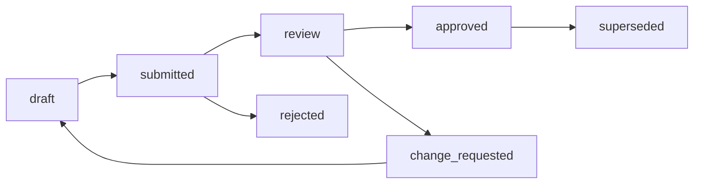

# 06. 任务、产物与角色工作空间模型

## 1. 核心实体

| 实体 | 说明 |
| --- | --- |
| Project | 一个游戏项目。 |
| Stage | 项目所处生产阶段。 |
| Room | 群聊房间。 |
| Message | 用户和 Agent 消息。 |
| Task | 可执行任务。 |
| TaskGroup | 大任务或里程碑任务组。 |
| Subtask | Task 的子任务，使用同一 Task 表和 `parent_task_id` 表达。 |
| Decision | 制作人决策。 |
| Artifact | 项目产物。 |
| Workspace | 角色工作空间。 |
| AuditEvent | 审计事件。 |

## 2. Project

```json
{
  "project_id": "game_...",
  "name": "点击防守小游戏",
  "status": "active",
  "current_stage": "production",
  "producer_id": "user_...",
  "created_at": "2026-07-15T00:00:00Z"
}
```

## 3. Task 层级

工作空间需要同时展示大任务和子任务状态。系统采用统一 Task 模型，通过 `task_level` 和 `parent_task_id` 表达层级，不额外引入割裂的任务实体。

任务层级：

```text
project
  stage
    task_group        大任务，例如“阶段 2：开发落地”
      task            角色任务，例如“实现核心点击防守玩法”
        subtask       可执行子任务，例如“实现敌人生成器”
```

层级规则：

- `task_group` 用于工作区顶部聚合展示，不直接由 Agent 执行。
- `task` 是角色级责任单元，必须有 owner agent。
- `subtask` 是可执行拆分项，可归属同一个 Agent 或交接给其他 Agent。
- 子任务状态会向上聚合到父任务和大任务。
- 任意子任务 `blocked` 时，父任务和大任务展示阻塞提示。

## 4. Task

任务状态：

```text
todo
doing
review
blocked
done
cancelled
```

工作区状态桶：

| UI 状态桶 | Task status | 含义 |
| --- | --- | --- |
| 进行中 | `doing`, `review` | 正在执行或等待评审。 |
| 阻塞中 | `blocked` | 需要外部输入、修复或审批。 |
| 待办 | `todo` | 已创建但未开始。 |
| 已完成 | `done` | 已完成并满足验收标准。 |

任务 Schema：

```json
{
  "task_id": "task_...",
  "project_id": "game_...",
  "stage_id": "production",
  "room_id": "engineering-room",
  "parent_task_id": "task_group_stage_2",
  "task_level": "task",
  "owner_agent_id": "gameplay_programmer",
  "title": "实现核心点击防守玩法",
  "description": "根据已审批 GDD 实现核心循环。",
  "status": "doing",
  "priority": 80,
  "sort_order": 120,
  "progress_percent": 45,
  "input_artifacts": ["artifact_gdd_core_loop"],
  "output_artifacts": [],
  "acceptance_criteria": [
    "点击反馈小于 100ms",
    "胜负条件与 GDD 一致",
    "失败和重开流程可用"
  ],
  "blockers": [],
  "created_at": "2026-07-15T00:00:00Z",
  "updated_at": "2026-07-15T00:00:00Z"
}
```

## 5. 大任务与子任务示例

```json
{
  "task_id": "task_group_stage_2",
  "task_level": "task_group",
  "title": "阶段 2：开发落地和可玩版本实现",
  "status": "doing",
  "progress_percent": 38,
  "children_summary": {
    "doing": 3,
    "blocked": 1,
    "todo": 5,
    "done": 4
  }
}
```

```json
{
  "task_id": "task_gameplay_core_loop",
  "parent_task_id": "task_group_stage_2",
  "task_level": "task",
  "owner_agent_id": "gameplay_programmer",
  "title": "实现核心点击防守玩法",
  "status": "doing",
  "children_summary": {
    "doing": 2,
    "blocked": 0,
    "todo": 1,
    "done": 3
  }
}
```

```json
{
  "task_id": "subtask_enemy_spawner",
  "parent_task_id": "task_gameplay_core_loop",
  "task_level": "subtask",
  "owner_agent_id": "gameplay_programmer",
  "title": "实现敌人生成器",
  "status": "done"
}
```

## 6. 任务状态聚合

父任务状态由子任务聚合得到：

| 子任务状态组合 | 父任务聚合状态 |
| --- | --- |
| 全部 `done` | `done` |
| 任意 `blocked` | `blocked` |
| 任意 `doing` 或 `review` | `doing` |
| 全部 `todo` | `todo` |
| 全部 `cancelled` | `cancelled` |

`progress_percent` 计算：

```text
progress = done_subtasks / effective_subtasks * 100
effective_subtasks = total_subtasks - cancelled_subtasks
```

没有子任务的 task 由自身状态决定进度：

```text
todo = 0
doing/review = 50
blocked = 50
done = 100
cancelled = null
```

## 7. Workspace Task Board

Workspace 右侧或独立任务页展示项目当前任务状态，结构与截图中的任务状态面板一致。

展示层级：

```text
项目名 / 当前对话任务
  总任务数、待办数、阻塞数、完成数
  进行中
    大任务卡片
      子任务卡片
  阻塞中
    大任务卡片
      子任务卡片
  待办
    大任务卡片
      子任务卡片
  已完成
    大任务卡片
      子任务卡片
```

任务卡片字段：

- 标题。
- 状态。
- owner agent。
- 所属阶段。
- 关联房间。
- 子任务计数。
- 阻塞原因。
- 关联产物。
- 最近更新时间。
- 下一步动作。

工作区任务摘要：

```json
{
  "project_id": "game_...",
  "scope": "current_room",
  "total": 13,
  "buckets": {
    "doing": 3,
    "blocked": 1,
    "todo": 5,
    "done": 4
  },
  "task_groups": [
    {
      "task_id": "task_group_stage_2",
      "title": "阶段 2：开发落地和可玩版本实现",
      "status": "blocked",
      "children_summary": {
        "doing": 3,
        "blocked": 1,
        "todo": 5,
        "done": 4
      }
    }
  ]
}
```

## 8. Decision

```json
{
  "decision_id": "decision_...",
  "project_id": "game_...",
  "stage_id": "concept_review",
  "producer_id": "user_...",
  "decision_type": "core_loop_approval",
  "verdict": "approved",
  "content": "核心玩法采用 60 秒点击防守循环。",
  "affected_tasks": ["task_..."],
  "affected_artifacts": ["artifact_..."],
  "supersedes": null,
  "created_at": "2026-07-15T00:00:00Z"
}
```

## 9. Artifact

产物类型：

```text
gdd
art_bible
asset_spec
asset
asset_manifest
scene_blueprint
source_code
build
qa_report
bug_report
deployment_report
rollback_plan
release_notes
```

产物 Schema：

```json
{
  "artifact_id": "artifact_...",
  "project_id": "game_...",
  "type": "art_bible",
  "path": "agents/art/art-bible.md",
  "owner_agent_id": "art_director",
  "stage_id": "concept_discussion",
  "status": "approved",
  "version": 3,
  "source_task_id": "task_...",
  "source_decision_ids": ["decision_..."],
  "checksum": "sha256:...",
  "created_at": "2026-07-15T00:00:00Z",
  "updated_at": "2026-07-15T00:00:00Z"
}
```

## 10. Workspace

工作空间目录：

```text
/studio/projects/{game_id}/
  shared/
    memory/
    decisions/
    milestones/
    task-board/
      current-status.json
      stage-task-groups.json
    build-artifacts/
    release-notes/
  agents/
    producer/
    design/
    art/
    engineering/
    cocos-automation/
    qa/
    devops/
```

每个角色目录必须包含：

- `workspace-summary.md`
- `task-status.json`
- 角色产物目录。
- 角色日志或报告。
- 与任务和 artifact 对应的文件。

`shared/task-board/current-status.json` 存储项目级任务状态摘要，供工作区快速渲染。各角色 `task-status.json` 存储角色视角任务状态，供制作人询问进度时快速读取。

## 11. 产物生命周期



状态说明：

- `draft`：Agent 草稿。
- `submitted`：已提交。
- `review`：等待制作人或 QA 审阅。
- `approved`：已审批。
- `change_requested`：需要修改。
- `rejected`：被否决。
- `superseded`：被新版本替代。

## 12. 任务和产物关联

规则：

- 每个产物必须有 owner agent。
- 每个正式产物必须关联 source task。
- 被制作人审批的产物必须关联 decision。
- QA 报告必须关联 build。
- Bug 报告必须关联截图、录屏或复现步骤。
- 发布记录必须关联构建、部署动作和回滚方案。
- 子任务完成后必须更新父任务状态聚合。
- 任务关联产物状态变化时必须刷新 Workspace Task Board。

## 13. 角色工作空间写入规则

Agent 只能写入：

- 自己的工作空间。
- 被授权的共享目录。
- 由任务指定的 Cocos 工程路径。

跨空间写入必须通过 handoff 或 Orchestrator 授权。

## 14. 工作区浏览

前端 Workspace Explorer 展示：

- 项目目录树。
- 大任务和子任务状态。
- `进行中 / 阻塞中 / 待办 / 已完成` 状态桶。
- 当前房间任务。
- 当前阶段任务组。
- 按角色过滤。
- 按 artifact 类型过滤。
- 最近变更。
- 产物审批状态。
- QA 关联证据。
- 审计事件。

敏感文件规则：

- `.env`、`.pem`、`.key`、`id_rsa*`、`secrets` 默认不展示。
- 脱敏后的服务器日志可展示。
- Secret Vault 内容不可通过 Workspace Explorer 读取。

## 15. 一致性策略

数据库和文件系统之间使用 Artifact Registry 做一致性维护：

- 文件写入后生成 checksum。
- Artifact Registry 记录路径和版本。
- 任务完成时校验产物存在。
- 阶段门禁检查 required artifacts。
- 删除文件必须生成 tombstone，不直接抹除历史。
- Task Store 状态变化后必须刷新 `shared/task-board/current-status.json`。
- 子任务状态变化后必须重新计算父任务和大任务聚合状态。

## 16. 示例：美术资产产物

```json
{
  "artifact_id": "asset_player_idle_001",
  "type": "asset",
  "path": "agents/art/processed-assets/player/char_player_idle_01.png",
  "owner_agent_id": "asset_production",
  "source_task_id": "task_generate_player_sprite",
  "source_decision_ids": ["decision_art_style_001"],
  "metadata": {
    "resolution": "512x512",
    "format": "png",
    "transparent": true,
    "runtime_ready": true
  }
}
```
