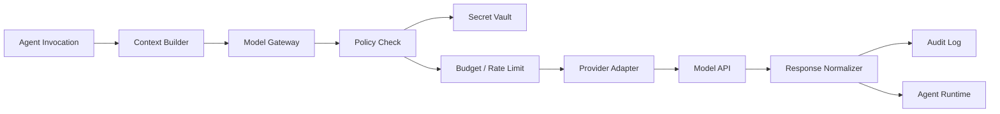

# 07. Model Gateway 与 API Key 安全

## 1. 定位

Model Gateway 是 Agent 到模型供应商之间的统一调用层。Agent 不直接持有 API key，不直接选择供应商，不直接读取明文密钥。Agent 只声明任务需要的能力，Gateway 根据权限、预算、策略和可用性选择模型并执行调用。

## 2. 调用链路



## 3. Agent 与模型解耦

Agent 配置只包含能力需求：

```yaml
model_profile:
  capability: reasoning
  cost_tier: standard
  context_policy: project_pack
  output_policy: structured_markdown
```

Gateway 负责映射：

```json
{
  "capability": "reasoning",
  "provider": "openai",
  "model": "example-reasoning-model",
  "credential_ref": "secret_model_openai_default"
}
```

## 4. 能力类型

| capability | 用途 | 典型 Agent |
| --- | --- | --- |
| `reasoning` | 策划、评审、任务拆解。 | Orchestrator, Producer, Designer |
| `coding` | TypeScript、Cocos、工具代码。 | Programmer, Cocos Tech Lead |
| `vision` | 截图理解、视觉 QA、资产审阅。 | QA, Art Director |
| `image_generation` | 角色、UI、背景、图标。 | Asset Production |
| `video_generation` | 动效参考、视频转序列帧。 | Asset Production |
| `embedding` | 产物和记忆检索。 | Memory System |
| `evaluation` | Benchmark 打分、门禁评估。 | QA, LiveOps |

## 5. API Key 存储

所有 key 存储在 Secret Vault。

Secret 结构：

```json
{
  "secret_id": "secret_model_openai_default",
  "project_id": "global",
  "provider": "openai",
  "type": "api_key",
  "scope": ["reasoning", "coding", "vision"],
  "created_by": "admin",
  "rotation_policy": "manual",
  "last_used_at": "2026-07-15T00:00:00Z"
}
```

规则：

- 明文 key 只在调用 Provider Adapter 时短暂解密。
- Agent 上下文不包含 key。
- Memory 不保存 key。
- Audit Log 只保存 `credential_ref`。
- 错误日志必须脱敏。

## 6. BYOK

BYOK 指制作人或项目方提供自己的模型 key。

隔离规则：

- BYOK key 绑定到 `project_id`。
- 不被其他项目复用。
- 可配置使用范围，例如仅图像生成。
- 可设置预算和调用上限。
- 项目删除时密钥进入撤销流程。

## 7. 权限策略

```json
{
  "agent_id": "asset_production",
  "allowed_capabilities": ["image_generation", "vision"],
  "denied_capabilities": ["deployment", "secret_read"],
  "monthly_budget_usd": 200,
  "max_single_call_usd": 5,
  "requires_approval_above_usd": 20
}
```

## 8. 调用请求 Schema

```json
{
  "request_id": "model_req_...",
  "project_id": "game_...",
  "agent_id": "game_designer",
  "capability": "reasoning",
  "purpose": "generate_core_loop_options",
  "input_context_refs": ["memory_pack_...", "artifact_gdd_draft"],
  "output_format": "json_schema",
  "budget_hint": {
    "max_tokens": 4000,
    "max_cost_usd": 1.5
  }
}
```

## 9. Provider Adapter

每个供应商实现统一接口：

```ts
interface ModelProviderAdapter {
  providerId: string;
  supports(capability: ModelCapability): boolean;
  invoke(request: NormalizedModelRequest): Promise<NormalizedModelResponse>;
  estimateCost(request: NormalizedModelRequest): Promise<ModelCostEstimate>;
}
```

返回结构：

```ts
interface NormalizedModelResponse {
  requestId: string;
  providerId: string;
  modelId: string;
  content: unknown;
  usage: {
    inputTokens?: number;
    outputTokens?: number;
    images?: number;
    videos?: number;
    costUsd?: number;
  };
  rawResponseRef?: string;
}
```

## 10. 成本和限流

Gateway 维护：

- per-project budget。
- per-agent budget。
- per-capability budget。
- per-provider rate limit。
- per-task cost accumulation。

超限处理：

- 低优先级任务排队。
- 高成本调用请求制作人确认。
- 可替换模型自动降级。
- 超预算任务进入 `blocked` 并记录原因。

## 11. 敏感信息脱敏

脱敏范围：

- API key。
- token。
- password。
- private key。
- server IP，按项目策略决定是否脱敏。
- Cookie。
- Authorization header。

脱敏规则：

```text
sk-abc123456789 -> sk-***6789
password=hello  -> password=***
Bearer token    -> Bearer ***
```

## 12. 审计事件

每次模型调用写入：

```json
{
  "event_type": "MODEL_INVOKED",
  "project_id": "game_...",
  "agent_id": "game_designer",
  "capability": "reasoning",
  "provider": "openai",
  "model": "example-reasoning-model",
  "credential_ref": "secret_model_openai_default",
  "usage": {
    "input_tokens": 1200,
    "output_tokens": 900,
    "cost_usd": 0.42
  },
  "status": "completed"
}
```

## 13. 失败处理

| 失败 | 处理 |
| --- | --- |
| Provider timeout | 重试，超过阈值切换备选模型。 |
| Rate limit | 队列延迟执行。 |
| Budget exceeded | 请求制作人或管理员确认。 |
| Invalid API key | 标记 secret 失效，通知 DevOps 或项目管理员。 |
| Unsafe output | 拦截输出，要求模型重试或交给人工审核。 |

## 14. 和 Agent 的边界

Agent 可以看到：

- 模型能力是否可用。
- 调用是否成功。
- 消耗摘要。
- 生成结果。

Agent 不能看到：

- API key 明文。
- Provider 原始鉴权头。
- Secret Vault 内容。
- 其他项目 BYOK 凭据。
