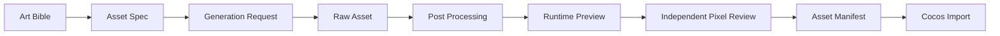

# 09. 美术 Agent 与资产流水线

## 1. Agent 基础

美术链由 Art Director、Asset Production 和独立 Visual Quality Reviewer 三个角色组成。本系统针对 2D 微信小游戏做以下约束：

- 面向 2D 微信小游戏。
- 输出运行时可用资产规格。
- 与 Asset Production Agent 分离。
- 创作与审查分离，作者不能审批自己的产物。
- 图片生成和视觉检查必须由真实多模态工具完成。
- 与 Cocos Automation Agent 通过 asset manifest 交接。
- 所有资产进入美术工作空间。

## 2. 美术角色边界

Art Director Agent：

- 定义视觉方向。
- 提交 Art Bible 与真实 PNG 视觉方向板。
- 制定资产规格。
- 把产物交给独立视觉审查。

Asset Production Agent：

- 生成或处理具体资产。
- 调用图像、视频、sprite 工具。
- 执行切图、透明、压缩、命名。
- 输出 runtime-ready 资产。

Visual Quality Reviewer：

- 以 Principal 2D Game Art Director 和移动技术美术人设工作。
- 读取真实图片像素，而不是只读 Art Bible 或 prompt。
- 输出绑定版本、哈希、固定 rubric 和模型追踪的质量审查收据。
- 只能请求修改或提交专业通过结论，不能替制作人批准门禁。

Technical Artist 能力由 Cocos Tech Lead 和 Asset Production 共同覆盖，主要处理性能、格式、尺寸、压缩和 Cocos 导入约束。

## 3. Art Bible 结构

```markdown
# Art Bible

## Visual Pillars
## Target Audience
## Reference Board
## Color Palette
## Shape Language
## Character Style
## Environment Style
## UI Visual Language
## Animation Tone
## VFX Direction
## Readability Rules
## Asset Format Rules
## Forbidden Styles
```

## 4. 资产规格

资产规格文件：

```text
agents/art/asset-specs/
  characters.md
  ui.md
  backgrounds.md
  vfx.md
  audio_refs.md
```

规格字段：

```json
{
  "asset_key": "char_basic_enemy_idle",
  "category": "character",
  "description": "基础敌人 idle sprite",
  "style_ref": "art-bible.md#character-style",
  "resolution": "256x256",
  "format": "png",
  "transparent": true,
  "animation": {
    "type": "sprite_sheet",
    "frames": 6,
    "fps": 8
  },
  "naming": "char_basic_enemy_idle_01.png",
  "cocos_import": {
    "type": "spriteFrame",
    "atlas": "characters"
  }
}
```

## 5. 资产目录

```text
agents/art/
  raw-assets/
    characters/
    ui/
    backgrounds/
    vfx/
  processed-assets/
    characters/
    ui/
    backgrounds/
    vfx/
  sprite-sheets/
  asset-manifest.json
  review-notes.md
```

raw-assets 保存模型输出和原始参考。processed-assets 保存清洗后资产。sprite-sheets 保存运行时图集和动画条。

SVG 是可编辑源资产，不是 Cocos 运行时交付格式。Asset Production Agent 必须通过服务端 `render_svg_to_png` 工具生成透明 PNG；源 SVG 和运行时 PNG 同时保留并分别登记证据。

## 6. Asset Manifest

```json
{
  "schemaVersion": "2.0.0",
  "project_id": "game_...",
  "assets": [
    {
      "asset_id": "asset_char_basic_enemy_idle",
      "asset_key": "char_basic_enemy_idle",
      "category": "character",
      "source_path": "agents/art/raw-assets/characters/enemy_idle_raw.png",
      "runtimePath": "assets/art/first-playable/char_basic_enemy_idle_01.png",
      "alphaPolicy": "required",
      "format": "png",
      "resolution": "256x256",
      "status": "approved",
      "owner_agent_id": "asset_production",
      "reviewed_by": "art_director"
    }
  ]
}
```

## 7. 工具接入

`generate_raster_asset` 调用受控图片模型并直接物化真实 PNG；`inspect_visual_assets` 把获准的本地图片字节交给视觉模型审查。默认使用 DashScope `wan2.7-image-pro` 生成、`qwen3.8-max` 检查。图像 provider key 由 Model Settings 保存，不写进资产仓库或模型上下文。详见 [21_quality_review_and_multimodal_art.md](./21_quality_review_and_multimodal_art.md)。

Stage 2 只接受 Asset Manifest v2。每个 `runtimePath` 必须显式声明 `alphaPolicy`：`required` 要求至少存在真实透明像素且图片不能全透明，`opaque` 禁止任何透明像素，`optional` 只用于确实没有透明契约的资产。系统会解码 PNG，而不是相信 `transparent: true` 之类的自述字段。

## 8. 资产生产流程



## 9. 后处理规则

后处理包括：

- 将 SVG 源资产通过受控渲染器转换为同名透明 PNG。
- 背景移除。
- 透明边缘修复。
- 帧切分。
- 角色锚点对齐。
- 尺寸归一化。
- sprite sheet 打包。
- 生成 GIF 预览。
- 压缩和格式检查。

处理结果必须保留：

- 原始文件。
- 处理后文件。
- 处理脚本和参数。
- 预览文件。
- metadata。

资产任务进入评审前必须同时满足：至少一个非联系表 runtime PNG 由 `generate_raster_asset` 产生；每个登记 SVG 派生物都有工具生成的 PNG；`asset-manifest.json` 的 `runtimePath` 指向当前 verified PNG；联系表已生成。任一条件不成立时，任务保持 `doing`。

## 10. 美术 QA

美术 QA 检查：

- 是否符合 Art Bible。
- 是否符合规格。
- 小屏幕是否可读。
- 透明通道是否正确。
- 动画是否抖动。
- 视觉层级是否清晰。
- 包体和纹理尺寸是否可接受。

评审记录使用严格 `ArtifactQualityReview`，而不是作者自填的简化批准对象：

```json
{
  "schemaVersion": "1.0.0",
  "kind": "artifact_quality_review",
  "domain": "visual_assets",
  "reviewerAgentId": "visual_quality_reviewer",
  "targets": ["绑定 artifactId/version/path/hash/size"],
  "verdict": "pass | change_requested | blocked"
}
```

## 11. Cocos 交接

Asset Production 完成后向 Cocos Automation Agent 交付：

- `asset-manifest.json`
- runtime assets。
- sprite sheet metadata。
- 动画帧配置。
- UI 组件资源。

Cocos Automation Agent 不直接使用 raw-assets。

## 12. 禁止规则

- 不生成侵犯 IP 的角色或风格。
- 不把 prompt 中的制作人隐私写入资产 metadata。
- 不把图像 provider key 写入仓库。
- 未经独立 Visual Quality Reviewer 检查真实像素并提交当前 `pass` 收据的资产不能进入 Cocos 构建。
- 未经 QA 检查的关键资产不能进入发布构建。
