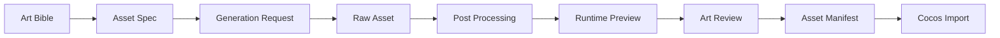

# 09. 美术 Agent 与资产流水线

## 1. Agent 基础

美术 Agent 以 `Claude-Code-Game-Studios/art-director` 为基础。该 Agent 已覆盖 Art Bible、风格规范、资产规格、UI 视觉方向、色彩、视觉层级和资产命名规则。

本系统对其进行以下适配：

- 面向 2D 微信小游戏。
- 输出运行时可用资产规格。
- 与 Asset Production Agent 分离。
- 与 Cocos Automation Agent 通过 asset manifest 交接。
- 所有资产进入美术工作空间。

## 2. 美术角色边界

Art Director Agent：

- 定义视觉方向。
- 审批 Art Bible。
- 制定资产规格。
- 审阅资产一致性。
- 给出美术门禁结论。

Asset Production Agent：

- 生成或处理具体资产。
- 调用图像、视频、sprite 工具。
- 执行切图、透明、压缩、命名。
- 输出 runtime-ready 资产。

Technical Artist 能力由 Cocos Tech Lead 和 Asset Production 共同覆盖，主要处理性能、格式、尺寸、压缩和 Cocos 导入约束。

## 3. Art Bible 结构

```markdown
# Art Bible

## Visual Pillars
## Target Audience
## Reference Board
## Color Palette
## Shape Language
## Character Style
## Environment Style
## UI Visual Language
## Animation Tone
## VFX Direction
## Readability Rules
## Asset Format Rules
## Forbidden Styles
```

## 4. 资产规格

资产规格文件：

```text
agents/art/asset-specs/
  characters.md
  ui.md
  backgrounds.md
  vfx.md
  audio_refs.md
```

规格字段：

```json
{
  "asset_key": "char_basic_enemy_idle",
  "category": "character",
  "description": "基础敌人 idle sprite",
  "style_ref": "art-bible.md#character-style",
  "resolution": "256x256",
  "format": "png",
  "transparent": true,
  "animation": {
    "type": "sprite_sheet",
    "frames": 6,
    "fps": 8
  },
  "naming": "char_basic_enemy_idle_01.png",
  "cocos_import": {
    "type": "spriteFrame",
    "atlas": "characters"
  }
}
```

## 5. 资产目录

```text
agents/art/
  raw-assets/
    characters/
    ui/
    backgrounds/
    vfx/
  processed-assets/
    characters/
    ui/
    backgrounds/
    vfx/
  sprite-sheets/
  asset-manifest.json
  review-notes.md
```

raw-assets 保存模型输出和原始参考。processed-assets 保存清洗后资产。sprite-sheets 保存运行时图集和动画条。

SVG 是可编辑源资产，不是 Cocos 运行时交付格式。Asset Production Agent 必须通过服务端 `render_svg_to_png` 工具生成透明 PNG；源 SVG 和运行时 PNG 同时保留并分别登记证据。

## 6. Asset Manifest

```json
{
  "manifest_version": 1,
  "project_id": "game_...",
  "assets": [
    {
      "asset_id": "asset_char_basic_enemy_idle",
      "asset_key": "char_basic_enemy_idle",
      "category": "character",
      "source_path": "agents/art/raw-assets/characters/enemy_idle_raw.png",
      "runtime_path": "agents/art/processed-assets/characters/char_basic_enemy_idle_01.png",
      "format": "png",
      "resolution": "256x256",
      "transparent": true,
      "status": "approved",
      "owner_agent_id": "asset_production",
      "reviewed_by": "art_director"
    }
  ]
}
```

## 7. 工具接入

`ai-game-art-pipeline-skill` 用于：

- 资产生产计划。
- 静态道具、图标、背景。
- 视频转帧工作流。
- 移动端 runtime 风险审计。

`agent-sprite-forge` 用于：

- 2D sprite。
- sprite sheet。
- 透明帧。
- GIF 预览。
- 小地图或可玩地图素材。
- 后处理脚本。

图像生成供应商通过 Model Gateway 接入，不把 provider SDK 和 key 写进资产仓库。

## 8. 资产生产流程



## 9. 后处理规则

后处理包括：

- 将 SVG 源资产通过受控渲染器转换为同名透明 PNG。
- 背景移除。
- 透明边缘修复。
- 帧切分。
- 角色锚点对齐。
- 尺寸归一化。
- sprite sheet 打包。
- 生成 GIF 预览。
- 压缩和格式检查。

处理结果必须保留：

- 原始文件。
- 处理后文件。
- 处理脚本和参数。
- 预览文件。
- metadata。

资产任务进入评审前必须同时满足：每个登记 SVG 都有同名 PNG、PNG 由工具调用产生并通过 Artifact Ledger 验证、`asset-manifest.json` 的 `runtime_path` 指向对应 PNG。任一条件不成立时，任务保持 `doing`。

## 10. 美术 QA

美术 QA 检查：

- 是否符合 Art Bible。
- 是否符合规格。
- 小屏幕是否可读。
- 透明通道是否正确。
- 动画是否抖动。
- 视觉层级是否清晰。
- 包体和纹理尺寸是否可接受。

评审记录：

```json
{
  "asset_id": "asset_char_basic_enemy_idle",
  "reviewer": "art_director",
  "verdict": "approved",
  "issues": [],
  "created_at": "2026-07-15T00:00:00Z"
}
```

## 11. Cocos 交接

Asset Production 完成后向 Cocos Automation Agent 交付：

- `asset-manifest.json`
- runtime assets。
- sprite sheet metadata。
- 动画帧配置。
- UI 组件资源。

Cocos Automation Agent 不直接使用 raw-assets。

## 12. 禁止规则

- 不生成侵犯 IP 的角色或风格。
- 不把 prompt 中的制作人隐私写入资产 metadata。
- 不把图像 provider key 写入仓库。
- 未经 Art Director 审阅的资产不能进入 runtime manifest。
- 未经 QA 检查的关键资产不能进入发布构建。
