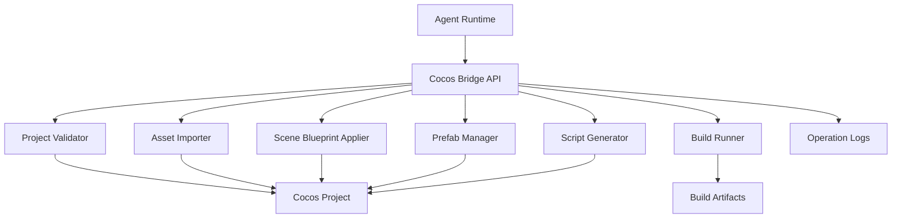

# 10. Cocos 引擎桥

## 1. 定位

Cocos Engine Bridge 是 Agent 与 Cocos Creator 的受控交互层。Agent 不直接无约束修改 `.scene`、`.prefab` 等复杂序列化文件，而是通过 SceneBlueprint、AssetManifest 和 Bridge 工具完成导入、场景构建、Prefab 更新和构建。

## 2. 技术目标

- 支持 Cocos Creator 3.8 LTS。
- 支持微信小游戏构建。
- 支持资产导入和索引。
- 支持场景树查询。
- 支持 SceneBlueprint 应用。
- 支持脚本生成和编译检查。
- 支持构建日志和编辑器操作日志留痕。

## 2.1 本机配置

Cocos Engine Bridge 使用本机安装的 Cocos Creator，不下载、不内嵌编辑器。制作人在设置页的 **Cocos Engine Bridge** 区域配置：

- Creator 可执行文件路径；
- Creator 版本，要求 3.8 或更高版本；
- 构建平台，当前固定为 `wechatgame`；
- Creator Build 面板导出的 `configPath`，可选；
- 单次构建超时，范围 1 至 60 分钟。

系统会扫描 macOS 常见的 `/Applications/CocosCreator/Creator/*`、`/Applications/Cocos/Creator/*` 和用户 Applications 目录。自动检测只保存真实存在且可执行的文件。连通性测试会启动 `CocosCreator --version`，不会仅根据路径字符串返回成功。

也可以在启动服务前使用环境变量覆盖本机配置：

```bash
export BTP_COCOS_EXECUTABLE="/Applications/CocosCreator/Creator/3.8.7/CocosCreator.app/Contents/MacOS/CocosCreator"
export BTP_COCOS_VERSION="3.8.7"
export BTP_COCOS_PLATFORM="wechatgame"
export BTP_COCOS_BUILD_CONFIG=""
export BTP_COCOS_TIMEOUT_MS="1200000"
```

## 3. Bridge 架构



## 4. 工具接口

```ts
interface CocosBridge {
  validateProject(input: ValidateProjectInput): Promise<ValidateProjectResult>;
  importAssets(input: ImportAssetsInput): Promise<ImportAssetsResult>;
  queryScene(input: QuerySceneInput): Promise<QuerySceneResult>;
  applySceneBlueprint(input: ApplySceneBlueprintInput): Promise<ApplySceneBlueprintResult>;
  updatePrefab(input: UpdatePrefabInput): Promise<UpdatePrefabResult>;
  generateScript(input: GenerateScriptInput): Promise<GenerateScriptResult>;
  build(input: BuildInput): Promise<BuildResult>;
}
```

当前 Cocos Automation Agent 的 Claude CLI Harness 和 Direct API Runtime 都暴露以下受控工具：

| 工具 | 真实行为 | 成功条件 |
| --- | --- | --- |
| `cocos_validate_project` | 校验项目根、`package.json`、`assets`、`settings`、Creator 可执行文件和版本。 | 工程结构有效且 Creator 3.8+ 可执行。 |
| `cocos_import_assets` | 读取 AssetManifest，校验 PNG 等 runtime 文件，复制到 `assets/resources/btp-art` 并生成资源映射和导入报告。 | 所有 runtime 文件存在、格式有效并完成物化。 |
| `cocos_apply_blueprint` | 解析 SceneBlueprint，生成受控场景、场景 meta、运行时描述、Bootstrap 组件及操作报告。 | 全部输出文件写入并计算 hash/size。 |
| `cocos_build` | 启动真实 Creator CLI 执行 `wechatgame` 构建。 | Creator 退出码为 `0` 或官方成功码 `36`，且输出目录出现本轮新构建文件。 |

执行顺序固定为：项目校验、资产导入、蓝图应用、微信构建。任一步失败后 Agent 必须进入 `blocked` 并引用失败报告，不能跳过或宣布构建完成。

## 5. SceneBlueprint

SceneBlueprint 是 Agent 可编辑的结构化场景中间层。

```json
{
  "blueprint_version": 1,
  "scene_name": "MainGame",
  "canvas": {
    "design_resolution": [750, 1334],
    "fit_width": true,
    "fit_height": false
  },
  "nodes": [
    {
      "id": "background",
      "type": "Sprite",
      "asset_key": "bg_main",
      "position": [0, 0],
      "size": [750, 1334],
      "z_index": 0
    },
    {
      "id": "score_label",
      "type": "Label",
      "text": "0",
      "position": [0, 580],
      "z_index": 10
    }
  ],
  "scripts": [
    {
      "node_id": "game_root",
      "component": "GameController",
      "properties": {
        "configPath": "assets/data/game_config.json"
      }
    }
  ]
}
```

Bridge 不允许模型直接编辑 Cocos 私有序列化结构。应用蓝图时会生成：

- `assets/resources/btp/scene-blueprint.json`：规范化运行时描述；
- `assets/scripts/btp/BtpRuntimeBootstrap.ts`：受控节点和组件物化入口；
- `assets/scenes/MainGame.scene` 与 `.meta`：Creator 可导入的启动场景；
- `agents/cocos-automation/scene-ops/*.json`：操作证据。

Bootstrap 会发现 `assets/scripts` 下带 `@ccclass` 的 Component 并建立受控组件注册表。Creator 在真实构建中负责 AssetDB 导入、TypeScript 编译、场景反序列化和资源引用校验。

## 6. AssetManifest 到 Cocos 导入

导入流程：

1. 读取 `agents/art/asset-manifest.json`。
2. 校验 runtime asset 存在。
3. 复制到 Cocos 工程资源目录。
4. 设置资源类型和图集。
5. 生成导入报告。
6. 更新 Artifact Registry。

导入报告：

```json
{
  "import_id": "import_...",
  "project_id": "game_...",
  "imported_assets": [
    {
      "asset_key": "char_basic_enemy_idle",
      "cocos_path": "assets/game/characters/char_basic_enemy_idle_01.png",
      "uuid": "cocos_uuid_..."
    }
  ],
  "status": "completed"
}
```

## 7. 脚本生成

脚本生成由 Gameplay Programmer Agent 提供逻辑规格，Cocos Bridge 负责落地文件和编译检查。

规则：

- TypeScript 代码进入 Cocos 工程脚本目录。
- 游戏参数通过 JSON 配置加载。
- 不在代码中硬编码策划数值。
- 组件名和文件名保持一致。
- 生成后执行静态检查或 Cocos 编译检查。

## 8. 构建

BuildInput：

```json
{
  "project_path": "workspace/game-project",
  "platform": "wechatgame",
  "build_mode": "debug",
  "output_dir": "shared/build-artifacts/wechat/dev",
  "config_path": "build-configs/wechat-debug.json"
}
```

未提供 `configPath` 时，Bridge 使用 Creator 官方命令行参数生成构建任务：

```text
CocosCreator --project <projectRoot> --build "platform=wechatgame;debug=true;buildPath=project://shared/build-artifacts/wechat;outputName=dev;startScene=<sceneUuid>;scenes=<sceneUuid>;logDest=<logPath>"
```

提供 Build 面板导出的配置后，Bridge 使用 `configPath=<path>;stage=build;logDest=<logPath>`。构建日志固定保存在 `agents/cocos-automation/cocos-build-logs/`，构建操作报告保存在 `agents/cocos-automation/build-ops/`。

BuildResult：

```json
{
  "build_id": "build_...",
  "platform": "wechatgame",
  "status": "success",
  "output_path": "shared/build-artifacts/wechat/dev",
  "logs_path": "agents/cocos-automation/cocos-build-logs/build_001.log",
  "duration_ms": 120000
}
```

## 9. 编辑器操作留痕

每次 Bridge 操作写入：

```json
{
  "operation_id": "cocos_op_...",
  "operation_type": "apply_scene_blueprint",
  "input_artifacts": ["scene-blueprints/main.json"],
  "output_artifacts": ["workspace/game-project/assets/scenes/MainGame.scene"],
  "status": "completed",
  "log_path": "agents/cocos-automation/scene-ops/op_001.json"
}
```

## 10. 与 Agent 的接口

| 调用方 | 调用内容 |
| --- | --- |
| Art Director | 查询资产是否正确导入和可读。 |
| Asset Production | 提交 manifest。 |
| Cocos Tech Lead | 定义项目结构和 blueprint schema。 |
| Gameplay Programmer | 生成脚本和配置。 |
| QA Agent | 触发构建和运行检查。 |
| WeChat Platform Agent | 获取微信构建产物。 |

## 11. 失败处理

| 失败 | 处理 |
| --- | --- |
| 资产缺失 | 标记 Asset Production 任务 blocked。 |
| Blueprint 无效 | 返回 schema 错误和节点路径。 |
| Cocos 编译失败 | 生成 build_failure 消息并交给 Programmer。 |
| 构建失败 | 保存完整脱敏日志并进入 QA/Engineering 修复。 |
| 编辑器命令超时 | 保存日志并立即标记 Cocos Automation blocked；修复环境后由制作人或调度器显式重试。 |

未安装或未配置 Creator 时，`cocos_validate_project` 和 `cocos_build` 会立即失败并写入报告。Agent Loop 不会再等待通用 Claude CLI 写出伪构建产物。

## 12. 禁止规则

- Agent 不直接批量正则改 `.scene`。
- 未进入 manifest 的资产不导入发布构建。
- 构建失败日志不得丢弃。
- Bridge 不读取 Secret Vault。
- 微信上传凭据由 WeChat Platform Agent 通过受控工具使用。
