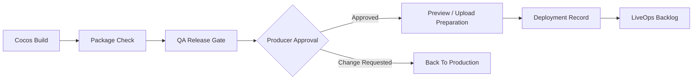

# 11. 微信小游戏发布流水线

## 1. 定位

微信小游戏发布流水线负责把 Cocos 构建产物转化为可预览、可检查、可上传准备的微信小游戏交付包，并和 QA 门禁、DevOps 部署、制作人审批形成闭环。

## 2. 输入和输出

输入：

- Cocos `wechatgame` 构建产物。
- 微信小游戏配置。
- 资源 manifest。
- QA 发布门禁报告。
- 制作人发布审批。

输出：

- 微信小游戏构建包。
- 包体检查报告。
- 预览配置。
- 上传准备报告。
- 发布说明。
- 回滚记录。

## 3. 构建目录

```text
shared/build-artifacts/
  wechat/
    dev/
      build/
      build-report.json
    release/
      build/
      package-report.json
      upload-report.json
```

## 4. 平台检查项

| 检查 | 说明 |
| --- | --- |
| 包体大小 | 主包和分包大小符合微信限制策略。 |
| 资源路径 | 资源路径和 CDN/远程资源策略一致。 |
| 启动性能 | 首屏加载时间在目标范围内。 |
| 适配 | 竖屏/横屏、设计分辨率、刘海屏安全区。 |
| 网络 | 请求域名和资源域名配置合法。 |
| 权限 | 不申请无关权限。 |
| 日志 | 不输出 secret 或调试敏感信息。 |
| 版本信息 | appid、版本号、构建号、commit 关联完整。 |

## 5. 构建配置

```json
{
  "platform": "wechatgame",
  "appid": "${WECHAT_APP_ID}",
  "orientation": "portrait",
  "build_number": "20260715.001",
  "version": "0.1.0",
  "subpackages": [],
  "remote_assets": {
    "enabled": false,
    "cdn_base_url": null
  }
}
```

`${WECHAT_APP_ID}` 从 Secret Vault 或项目配置引用，不写入公开日志。

## 6. 发布流程



## 7. 包体报告

```json
{
  "package_report_id": "pkg_...",
  "build_id": "build_...",
  "main_package_size_mb": 3.8,
  "subpackage_size_mb": 0,
  "asset_count": 124,
  "largest_assets": [
    {
      "path": "assets/game/backgrounds/bg_main.png",
      "size_kb": 420
    }
  ],
  "status": "passed"
}
```

## 8. QA 门禁关系

微信发布不能绕过 QA 门禁。

可进入发布准备的条件：

- Cocos 构建成功。
- Runtime Playability 通过。
- Gameplay Correctness 通过或制作人豁免。
- WeChat Readiness 通过。
- Security and Ops 无 critical 风险。

## 9. 上传准备

上传准备产物：

```json
{
  "upload_report_id": "upload_...",
  "build_id": "build_...",
  "appid_ref": "secret_wechat_appid",
  "version": "0.1.0",
  "description": "首个可玩版本",
  "status": "ready",
  "created_at": "2026-07-15T00:00:00Z"
}
```

涉及上传 token、私钥或 CLI 凭据时，通过受控工具调用，不进入 Agent 上下文。

## 10. 发布记录

发布记录字段：

- `release_id`
- `project_id`
- `build_id`
- `git_commit`
- `producer_decision_id`
- `qa_gate_id`
- `package_report_id`
- `deployment_report_id`
- `rollback_plan_id`
- `status`

## 11. 回滚

回滚方案包含：

- 上一稳定构建。
- 资源版本。
- 服务器版本。
- 配置版本。
- 回滚命令。
- 验证步骤。

回滚计划存储：

```text
agents/devops/rollback-plans/rollback-{release_id}.md
```

## 12. LiveOps 交接

发布完成后，WeChat Platform Agent 向 LiveOps / Analytics Agent 交接：

- release notes。
- build id。
- QA 已知问题。
- 埋点配置。
- 迭代 backlog。
- 制作人后续关注点。

## 13. 失败处理

| 失败 | 责任角色 |
| --- | --- |
| 包体超限 | WeChat Platform, Art, Engineering |
| 构建失败 | Cocos Automation, Gameplay Programmer |
| QA 不通过 | QA, 相关责任 Agent |
| 上传凭据无效 | DevOps, WeChat Platform |
| 生产资源不可达 | DevOps |

所有失败进入 `build_failure`、`qa_failure` 或 `blocker` 消息，并写入 Audit Log。
