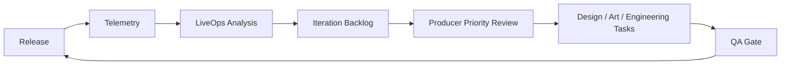

# 13. DevOps、LiveOps 与持续迭代

## 1. 定位

DevOps 负责生产环境交付、服务器操作、日志、回滚和健康检查。LiveOps 负责上线后的数据分析、反馈收集、调优方案和迭代 backlog。两者共同保证游戏从“可玩构建”进入“可运营产品”。

## 2. Secret Vault

服务器访问权限、云服务 key、微信上传凭据全部进入 Secret Vault。

Secret 类型：

```text
server_ssh
server_password
cloud_access_key
wechat_appid
wechat_upload_key
cdn_token
database_password
```

Agent 只获得受控工具能力，不获得明文 secret。

## 3. 部署计划

部署计划存储在：

```text
agents/devops/deploy-plans/deploy-{release_id}.md
```

内容：

- 部署目标。
- 依赖服务。
- 构建产物。
- 配置项。
- Secret 引用。
- 部署步骤。
- 验证步骤。
- 回滚步骤。

## 4. 部署任务 Schema

```json
{
  "deploy_task_id": "deploy_...",
  "project_id": "game_...",
  "release_id": "release_...",
  "target_environment": "production",
  "artifact_refs": ["build_wechat_release_001"],
  "secret_refs": ["secret_server_ssh_001"],
  "status": "pending_approval",
  "requires_producer_approval": true
}
```

## 5. 部署执行

流程：

1. QA 发布门禁通过。
2. 制作人审批发布。
3. DevOps Agent 获取受控部署工具。
4. 工具层从 Secret Vault 获取临时凭据。
5. 执行部署。
6. 保存脱敏日志。
7. 执行健康检查。
8. 写入 Release Memory 和 Audit Log。

## 6. 部署记录

```json
{
  "deployment_report_id": "deploy_report_...",
  "project_id": "game_...",
  "release_id": "release_...",
  "environment": "production",
  "status": "success",
  "started_at": "2026-07-15T00:00:00Z",
  "finished_at": "2026-07-15T00:05:00Z",
  "logs_path": "agents/devops/deployment-reports/deploy_001.log",
  "rollback_plan_path": "agents/devops/rollback-plans/rollback_001.md"
}
```

## 7. 日志脱敏

日志进入工作空间前必须脱敏：

- token。
- password。
- private key。
- Authorization header。
- Cookie。
- 数据库连接串。
- 服务器内网地址，按项目策略处理。

## 8. 健康检查

健康检查项：

- 静态资源可访问。
- 后端接口可访问。
- HTTPS 证书正常。
- 错误率在阈值内。
- 日志无 critical error。
- 构建版本和 release id 对齐。

结果：

```json
{
  "health_check_id": "health_...",
  "release_id": "release_...",
  "checks": [
    {
      "name": "static_assets",
      "status": "passed"
    }
  ],
  "status": "healthy"
}
```

## 9. 回滚

回滚触发条件：

- 生产环境不可用。
- 关键资源加载失败。
- 用户无法进入游戏。
- QA 或制作人要求回退。

回滚必须：

- 使用上一个稳定构建。
- 记录回滚原因。
- 记录执行人和工具调用。
- 保存脱敏日志。
- 更新 Release Memory。

## 10. LiveOps 埋点

基础事件：

```json
[
  "game_start",
  "game_ready",
  "level_start",
  "level_complete",
  "level_fail",
  "restart",
  "button_click",
  "asset_load_error",
  "runtime_error"
]
```

事件结构：

```json
{
  "event_name": "level_complete",
  "project_id": "game_...",
  "release_id": "release_...",
  "session_id": "session_...",
  "level_id": "level_001",
  "duration_seconds": 58,
  "score": 920,
  "timestamp": "2026-07-15T00:00:00Z"
}
```

## 11. 迭代 backlog

LiveOps Agent 将数据和制作人反馈转成 backlog：

```json
{
  "item_id": "iter_...",
  "source": "analytics",
  "title": "第一关失败率过高",
  "evidence": "level_001 fail_rate = 72%",
  "owner_agent_id": "game_designer",
  "priority": 80,
  "status": "todo"
}
```

## 12. 持续迭代流程



## 13. DevOps 禁止规则

- 不在消息中展示明文密码。
- 不把私钥写入工作空间。
- 不绕过 QA 和制作人审批部署。
- 不覆盖旧部署记录。
- 不删除失败日志。

## 14. LiveOps 禁止规则

- 不收集无关个人信息。
- 不基于不足数据做确定性结论。
- 不自动改数值上线。
- 不绕过制作人优先级审批。
