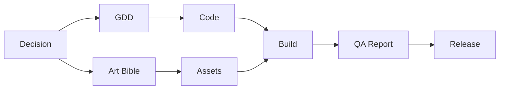

# 15. 可观测性、审计与可追溯性

## 1. 目标

系统必须让制作人和维护者清楚看到：

- 谁在做什么。
- 为什么这么做。
- 输入是什么。
- 输出是什么。
- 使用了哪些工具和模型。
- 哪个决策批准了该动作。
- 出错时责任归属和复现材料在哪里。

## 2. 审计日志原则

- Append-only。
- 不覆盖历史。
- 不保存 secret 明文。
- 每个关键动作都有 event id。
- 事件能关联 task、artifact、decision、agent、tool call。

## 3. AuditEvent Schema

```json
{
  "event_id": "evt_...",
  "project_id": "game_...",
  "stage_id": "production",
  "agent_id": "cocos_automation",
  "task_id": "task_...",
  "event_type": "COCOS_BUILD_COMPLETED",
  "input_artifacts": ["scene_blueprint_main"],
  "output_artifacts": ["build_wechat_dev_001"],
  "tool_calls": [
    {
      "tool_call_id": "tool_...",
      "tool_name": "cocos.build",
      "status": "completed",
      "duration_ms": 120000
    }
  ],
  "decision_refs": ["decision_core_loop_approval"],
  "status": "completed",
  "failure_reason": null,
  "metadata": {
    "build_platform": "wechatgame"
  },
  "created_at": "2026-07-15T00:00:00Z"
}
```

## 4. Tool Call Trace

工具调用记录：

```json
{
  "tool_call_id": "tool_...",
  "event_id": "evt_...",
  "tool_name": "asset.postprocess",
  "input_summary": "处理 enemy idle sprite",
  "output_summary": "生成透明 PNG 和 GIF 预览",
  "status": "completed",
  "started_at": "2026-07-15T00:00:00Z",
  "finished_at": "2026-07-15T00:00:03Z"
}
```

输入输出摘要必须脱敏。大文件使用 artifact ref。

## 5. Agent Invocation Trace

记录：

- invocation id。
- agent id。
- room id。
- source message。
- memory pack ref。
- model request id。
- output message id。
- status。
- duration。
- cost。

## 6. 产物血缘

产物血缘回答：

- 这个构建来自哪个 commit。
- 使用了哪些资产。
- 依据哪个 GDD。
- 通过了哪些 QA 检查。
- 制作人在哪个决策中批准。

血缘图：



## 7. 制作人白盒视图

界面展示：

- 当前阶段。
- 每个 Agent 当前任务。
- 每个 Agent 工作空间。
- 阻塞项。
- 待审批决策。
- 最近产物。
- QA 问题。
- 发布状态。
- 关键审计事件。

## 8. 成本和性能观测

模型调用指标：

- input tokens。
- output tokens。
- 图片数量。
- 视频数量。
- 调用费用。
- 重试次数。
- 延迟。

工具调用指标：

- Cocos 构建耗时。
- 资产处理耗时。
- QA 自动试玩耗时。
- 部署耗时。

## 9. 失败归因

失败必须关联责任角色：

| 失败 | 责任归属 |
| --- | --- |
| GDD 缺少机制边界 | Game Designer |
| Art Bible 与资产不一致 | Art Director / Asset Production |
| TypeScript 编译失败 | Gameplay Programmer |
| 场景构建失败 | Cocos Automation |
| QA 无法运行 | QA / Engineering |
| 包体超限 | WeChat Platform / Art |
| 部署失败 | DevOps |

归因不是惩罚机制，而是追溯和修复路径。

## 10. 脱敏策略

脱敏发生在：

- 模型请求前。
- 工具日志入库前。
- 审计事件写入前。
- 工作空间展示前。
- 导出报告前。

脱敏结果保留可诊断性：

```text
server=***.***.12.34
token=***abcd
password=***
```

## 11. 告警

告警类型：

- 构建连续失败。
- QA critical bug。
- Secret 使用失败。
- 预算接近上限。
- 部署失败。
- 发布包包含疑似 secret。
- Agent 多次超时。

告警进入 `#studio-main`，并可路由给相关 Agent。

## 12. 审计查询

典型查询：

- 查询某个 release 的完整血缘。
- 查询某个 Bug 的产生和修复过程。
- 查询制作人所有否决决策。
- 查询某个 Agent 本周完成任务。
- 查询所有模型调用成本。
- 查询所有部署动作。

## 13. 保留策略

- AuditEvent 长期保留。
- 构建日志按 release 保留。
- 临时 raw asset 可按策略归档。
- QA 证据保留到至少下一个稳定 release。
- Secret 使用日志长期保留，但不含明文。
