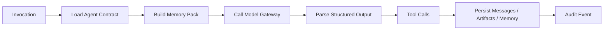

# 17. 交付计划与工程任务

## 1. 工程目标

工程实现覆盖完整产品系统：

- Studio Chat。
- Agent Registry。
- Workflow Orchestrator。
- Task and Mission Hub。
- Production Memory System。
- Role Workspaces。
- Artifact Registry。
- Model Gateway。
- Cocos Engine Bridge。
- Asset Pipeline。
- QA and Evaluation Harness。
- WeChat Release Pipeline。
- DevOps and LiveOps。
- Audit and Observability。

## 2. 仓库结构

```text
game-pineline-agents/
  apps/
    web/
    api/
  packages/
    agent-runtime/
    model-gateway/
    workflow/
    memory/
    artifact-registry/
    cocos-bridge/
    qa-harness/
    devops-tools/
    shared-schemas/
  docs/
  templates/
    cocos-wechat-minigame/
  studio/
    projects/
```

## 3. 后端服务

API 服务职责：

- 用户和项目管理。
- 房间和消息。
- Agent invocation。
- Task Store。
- Artifact Registry。
- Memory。
- Audit Log。
- Secret Vault 集成。
- Model Gateway。
- Cocos Bridge 调用。

核心 API：

```text
POST /projects
GET  /projects/:projectId
POST /projects/:projectId/messages
GET  /projects/:projectId/rooms
GET  /projects/:projectId/tasks
GET  /projects/:projectId/task-board
GET  /projects/:projectId/tasks/:taskId/subtasks
PATCH /projects/:projectId/tasks/:taskId/status
POST /projects/:projectId/decisions
GET  /projects/:projectId/artifacts
GET  /projects/:projectId/memory
GET  /projects/:projectId/audit-events
POST /projects/:projectId/agent-invocations
```

## 4. 前端工作室界面

界面模块：

- 项目首页。
- 三阶段节点图。
- 群聊房间。
- Agent 状态栏。
- 待制作人决策面板。
- 任务看板。
- Workspace Task Board：大任务、子任务、状态桶和阻塞上浮。
- 工作空间浏览器。
- 产物注册表。
- QA 报告。
- 发布面板。
- 审计日志。

## 5. Agent Runtime

Runtime 负责：

- 加载 Agent 配置。
- 构建上下文。
- 调用 Model Gateway。
- 调用工具。
- 写回消息、任务、记忆和审计。
- 处理失败和重试。

执行流程：



## 6. Model Gateway 工程任务

任务：

- 定义 provider adapter interface。
- 实现文本模型 adapter。
- 实现图像模型 adapter。
- 实现 embedding adapter。
- 实现 budget manager。
- 实现 redaction。
- 实现 model invocation audit。
- 实现 BYOK secret 绑定。

## 7. Memory 工程任务

任务：

- 建立 memory 数据表。
- 实现 memory write API。
- 实现 status transition。
- 实现 context builder。
- 实现 vector indexing pipeline。
- 实现 workspace-summary 同步。
- 实现 secret filtering。

## 8. Workflow 工程任务

任务：

- 实现三阶段状态机。
- 实现 phase gate。
- 实现 producer approval。
- 实现 change request。
- 实现 rollback stage transition。
- 实现 task batch generation。
- 实现 task group 和 subtask 拆解。
- 实现子任务状态向父任务聚合。
- 实现 blocker handling。
- 实现 Workspace Task Board 快照刷新。

## 9. Chat 和 Routing 工程任务

任务：

- 实现 Room。
- 实现 Message Store。
- 实现 mention parser。
- 实现 intent classifier。
- 实现 relevance scoring。
- 实现 Invocation Queue。
- 实现并行和串行策略。
- 实现 Orchestrator 汇总。

## 10. Workspace Task Board 工程任务

任务：

- 实现大任务、任务、子任务三层树。
- 实现 `进行中 / 阻塞中 / 待办 / 已完成` 状态桶。
- 实现状态计数。
- 实现阻塞上浮。
- 实现按阶段、房间、Agent 过滤。
- 实现任务卡片展开和折叠。
- 实现任务到群聊消息、产物、审计事件的跳转。
- 实现 `shared/task-board/current-status.json` 同步。

## 11. Cocos Bridge 工程任务

任务：

- 定义 SceneBlueprint schema。
- 实现 Cocos 项目校验。
- 实现 asset manifest 导入。
- 实现场景树查询。
- 实现 blueprint apply。
- 实现脚本生成和编译检查。
- 实现 wechatgame build。
- 实现构建日志收集。

## 12. Asset Pipeline 工程任务

任务：

- 定义 asset spec schema。
- 定义 asset manifest schema。
- 接入 image generation provider。
- 接入 sprite forge 后处理。
- 实现图片清洗和尺寸归一。
- 实现 sprite sheet 打包。
- 实现 asset review。
- 实现 Cocos import handoff。

## 13. QA Harness 工程任务

任务：

- 定义 Cocos MiniGame Bench schema。
- 实现构建启动。
- 实现截图和录屏。
- 实现输入回放。
- 实现 GDD 对照检查。
- 实现 Art Bible 对照检查。
- 实现 bug report 生成。
- 实现 release gate。

## 14. WeChat 和 DevOps 工程任务

任务：

- 实现微信构建包检查。
- 实现包体报告。
- 实现上传准备报告。
- 实现 deploy plan。
- 实现 Secret Vault 工具调用。
- 实现日志脱敏。
- 实现 deployment report。
- 实现 rollback plan。

## 15. 数据库迁移

迁移顺序：

1. projects。
2. rooms。
3. messages。
4. tasks。
5. task_status_snapshots。
6. decisions。
7. artifacts。
8. memories。
9. invocations。
10. audit_events。
11. secrets metadata。

## 16. 测试策略

测试类型：

- 单元测试：routing、state machine、schema validation。
- 单元测试：task hierarchy、status aggregation、blocked bubbling。
- 集成测试：message -> invocation -> memory -> artifact。
- 集成测试：subtask status update -> parent task summary -> workspace board snapshot。
- Cocos Bridge 测试：blueprint apply、build result。
- QA Harness 测试：playtest report、bug report。
- 安全测试：secret redaction、workspace forbidden file。
- 端到端测试：idea -> GDD -> Art Bible -> Cocos build -> QA gate。

## 17. 本地开发环境

服务：

- API server。
- Web app。
- PostgreSQL。
- Redis 或队列服务。
- Object storage mock。
- Cocos Bridge worker。
- Agent worker。

配置：

```text
DATABASE_URL=
REDIS_URL=
STUDIO_WORKSPACE_ROOT=
SECRET_VAULT_PROVIDER=
MODEL_GATEWAY_CONFIG=
COCOS_CREATOR_PATH=
```

## 18. 交付验收

工程系统验收：

- 制作人可创建项目并输入 idea。
- 策划和美术 Agent 可完成开局讨论。
- GDD 和 Art Bible 可写入工作区。
- 任务系统可展示角色任务。
- 工作空间可展示大任务、子任务、状态桶和状态计数。
- 子任务状态变化可自动更新父任务和大任务状态。
- 生产记忆可写入和注入。
- Model Gateway 可调用模型且不暴露 key。
- Cocos Bridge 可生成或校验 Cocos 构建。
- QA 可生成试玩报告。
- 发布面板可展示微信构建和部署状态。
- Audit Log 可追溯关键动作。
