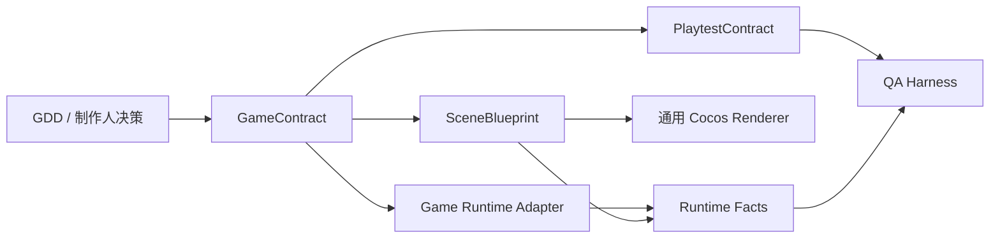

# Game、Scene 与 Playtest 契约

## 1. 状态与目标

本章定义第一版通用游戏生产契约。当前 Cocos Bridge 与 QA Harness 已完成第一段契约迁移；游戏脚本侧 Runtime Adapter、真实微信环境和三套真实品类工程仍待端到端接通。

契约层的目标是让策划、工程、Cocos 自动化和 QA 围绕同一组结构化事实协作：

- 策划声明游戏是什么、玩家能做什么、怎样观察进度。
- 场景蓝图声明引擎需要创建什么，以及它与游戏事实如何绑定。
- Playtest 声明 QA 要执行什么，以及只依据哪些公开事实判断结果。
- 不同品类游戏通过更换契约和模板生产，不修改工作流内核、Bridge 或 QA 的业务分支。

契约的 TypeScript 类型、常量和零依赖运行时校验位于：

```text
packages/shared-schemas/src/gameContracts.ts
```

自动验证位于：

```text
scripts/verify-game-contracts.mjs
```

## 2. 契约关系与依赖方向



依赖必须保持单向：

1. `GameContract` 不依赖 Cocos、场景节点或测试实现。
2. `SceneBlueprint` 和 `PlaytestContract` 引用同一个 `GameContract.contractId + revision`。
3. Scene 与 Playtest 之间没有隐式业务耦合；需要定位画面元素时，只使用 Scene 提供的稳定 `testId`。
4. Bridge 解释 Scene，Runtime 实现 Game，QA 执行 Playtest 并读取 Runtime Facts。
5. 毛线球、拼图、跑酷等品类差异只能存在于契约、资产和可替换模板中，不能进入通用编排器或 Renderer 的组件名特判。

## 3. GameContract：游戏语义的唯一事实源

`GameContract` 描述引擎无关、可测试的游戏行为，其边界如下：

| 分区 | 责任 |
| --- | --- |
| `identity` | 稳定 `contractId`、`gameId`、标题、slug、内容 revision 和发布版本。 |
| `genre` | 主品类、标签、视觉维度和玩家模式；用于路由模板，不用于写死玩法。 |
| `coreLoop` | 核心循环步骤、可用 action、涉及 state、发出的 signal，以及成功/失败条件。 |
| `stateModel` | 初始状态、状态定义、合法转换、触发器、guard 和转换产生的 signal。 |
| `inputModel` | 语义化 action 及其 touch、mouse、keyboard、gamepad、virtual 绑定。 |
| `runtimeSignals` | Runtime 对外发布的 typed facts，包括 event、boolean、integer、number、string。 |

### 3.1 生命周期

- `finite` 游戏必须具有 success state 和成功条件。
- `endless` 游戏不要求终局或成功条件；Playtest 可把 `playing` 等非终局状态作为预期结束状态。
- success/failure state 是 terminal；它们只能通过显式 `system/restart` 转回初始状态。
- transition、core loop、input state 和 condition 中的所有引用必须能够解析到同一契约内的 ID。

### 3.2 Runtime signal 可见性

- `public` signal 是 Game Runtime 与 QA、HUD、遥测之间的稳定接口。
- `internal` signal 仅供实现内部协调，不允许 Playtest assertion 或质量门禁读取。
- Playtest 不得读取 `_remainingTime`、Controller 私有字段或特定脚本实例。
- 有序比较只能用于 integer/number；signal 初始值和断言值必须与声明类型一致。

GameContract 不负责场景布局、Prefab 路径、Cocos 组件名、截图坐标或部署配置。

## 4. SceneBlueprint：声明式呈现与装配

`SceneBlueprint` 把游戏语义映射为引擎可渲染的场景结构。它包含：

- 入口场景和 boot、gameplay、result、overlay 场景列表。
- 节点的稳定 `nodeId`、全蓝图唯一 `testId`、父子关系、transform 和 tags。
- Prefab 的稳定 `prefabId`、来源、root node 和公开组件。
- 组件类型、JSON-compatible properties、契约 binding 和显式 entity reference。
- `node`、`component`、`prefab` 三类结构化引用；不使用字符串路径猜测依赖。

`testId` 是自动化定位接口，不是显示名称。重命名 Cocos Node、调整层级或替换 Prefab 时，只要交互语义不变，`testId` 就应保持稳定。

### 4.1 Renderer 约束

通用 Bridge Renderer 必须按 `kind`、`type`、`properties`、`bindings` 和 `references` 解释蓝图。不得出现以下模式：

- 根据 `YarnBallController`、`BasketController`、拼图格或跑酷角色等业务组件名进入特殊分支。
- 根据节点显示名称推断 gameplay 语义。
- 在 Bridge 内创建某一品类专属 Prefab 或写死 HUD 字段。

品类扩展需要新能力时，应增加通用 component adapter，或者在独立模板/plugin 中实现，并通过声明式 properties 使用；不应把样例逻辑放回 Bridge 主流程。

由 Bridge 写入 Cocos Resources 的运行时 descriptor 是派生产物，不是 SceneBlueprint 的事实源。修改必须从已验证蓝图开始，派生产物不得反向覆盖契约。

同一组件属性只能由 `properties`、`bindings`、`references` 三者之一赋值；重复目标会在契约校验阶段失败。属性名必须是安全的 JavaScript 字段名，`__proto__`、`constructor` 等原型链键会被拒绝。当前 v1 renderer 将 binding 的稳定 `ref` 注入组件字段，游戏侧 Runtime Adapter 负责把这些语义 ID 连接到实际 action、state 和 public signal 通道。

## 5. PlaytestContract：公开行为验收

`PlaytestContract` 描述可重复、可证明的运行时验证：

| 分区 | 责任 |
| --- | --- |
| `environment` | web、微信开发者工具或真机目标，方向、viewport 和场景总超时。 |
| `scenarios` | 起始状态、步骤序列、预期结束状态和所需证据。 |
| `steps` | system/input/wait action，以及 state/signal/node assertion。 |
| `repeat.until` | 在明确次数上限内重复 action，直到公开 assertion 成立。 |
| `qualityGates` | 对公开 signal 做 last/min/max/average/sum 聚合和阈值判断。 |

### 5.1 必需项与有界执行

- 每个 scenario 都重新加载游戏，不继承前一个用例的运行状态。v1 没有隐藏 fixture/set-state 接口；所有 `startState` 必须相同，各用例通过自己的真实输入步骤建立建造、战斗、暂停或终局前置条件。`startState` 是断言，不是导航指令。
- `qualityGates` 聚合整次运行的全部快照，没有按用例名或状态隐式筛选。互相矛盾的全局等值/阈值条件会被拒绝；胜利 HP>0 与失败 HP=0 这类分支标准应保留在各自步骤断言中，不能为了通过校验删除必要覆盖。
- Release gate 至少需要一个 `required: true` scenario。
- Required scenario 至少需要一个 `required: true` step。
- 非 required 项可以提供探索性覆盖，但失败不能伪装为 required gate 通过。
- 单步超时最大为 60 秒，单场景最大为 300 秒。
- `repeat.maxIterations` 最大为 100；单步全部重复、轮询和断言共享 `timeoutMs` 的绝对截止时间，不再次乘循环次数。全部步骤的 `timeoutMs` 之和不得超过场景超时，执行器还会对包括重载和取证的整场景施加硬超时。
- `repeat.until` 必须包含至少一个 assertion，禁止无条件或无限循环。

没有终局的游戏可以在观察窗口结束后断言仍处于 active state。支持重开的游戏使用 `system/restart` action，并依据 GameContract 的显式 restart transition 验证新一轮状态。

### 5.2 Assertion 边界

- state assertion 只引用 `GameContract.stateModel`。
- signal assertion 和 quality gate 只引用 `public runtimeSignals`。
- node assertion 只引用 `SceneBlueprint.testId`，不引用 Cocos Node 名称或脚本字段。
- assertion 中的 action、state、signal、testId 必须通过跨契约引用校验。
- required artifact 可以声明 screenshot、video、runtime trace、console log 和 metrics；只有真实采集并进入 Artifact Ledger 后才构成证据。

## 6. 建议的项目产物路径

当前本地 MVP 使用以下规范路径：

```text
agents/design/contracts/game-contract.json
agents/engineering/cocos-scene-blueprints/main.scene-blueprint.json
agents/qa/contracts/core-loop.playtest-contract.json
```

Bridge 可生成以下运行时副本：

```text
assets/resources/btp/scene-blueprint.json
```

运行时副本必须记录来源 artifact、checksum、`contractId` 和 revision。项目进入下一阶段前，三份源契约都必须作为独立 Artifact 注册、真实物化并通过 bundle compatibility 校验，不能由 Artifact 元数据占位文件代替。

验证脚本目前在内存中构造三套 fixture：

- tap-defense：离散拦截 action 和 integer progress signal。
- puzzle：选格 action 和 boolean solved signal。
- runner：jump action 和 number distance signal。

三套 fixture 共享同一 schema、解析器和 QA 语义，不共享业务 Controller。

## 7. 版本、revision 与严格校验

三类 schema 独立版本化，第一版均为 `1.0.0`：

```text
GAME_CONTRACT_SCHEMA_VERSION
SCENE_BLUEPRINT_SCHEMA_VERSION
PLAYTEST_CONTRACT_SCHEMA_VERSION
```

版本规则：

1. `schemaVersion` 描述数据结构版本；`identity.revision` 或蓝图/测试 revision 描述项目内容修订，两者不能混用。
2. Scene 和 Playtest 必须精确引用 GameContract 的 `contractId + revision`，避免新玩法定义与旧场景、旧测试被拼接。
3. 当前 parser 只接受明确支持的 schemaVersion。升级 schema 前必须先增加 parser/migration，再写新版本产物。
4. 所有 object 都执行 strict-key 校验；拼错字段和未知字段直接失败，不能静默忽略。
5. `validate*` 返回带 path、code、message 的结构化结果；`parse*` 失败时抛出 `ContractValidationError`。
6. `validateProductionContractBundle` 同时执行三份 shape/semantic 校验和跨契约 compatibility 校验，是进入 Bridge 和 QA 前的标准入口。

修改契约内容后必须递增 revision，重新验证 Scene/Playtest，并使旧 Artifact 进入 superseded 状态。仅修正文案且不改变运行时语义时，也应由项目策略明确是否递增，而不能覆盖已审批事实。

## 8. Runtime Facts 协议

Game Runtime Adapter 是实现层与 QA 之间的防腐层。构建通过 `globalThis.__BTP_PLAYTEST__` 暴露只读事实和语义动作；Adapter 不能发布 QA verdict。握手与快照线格式如下：

```json
{
  "protocolVersion": "1.0.0",
  "playtestId": "sky_runner.playtest",
  "revision": 1,
  "contractHash": "sha256-of-playtest-contract"
}
```

```json
{
  "sequence": 42,
  "timestampMs": 1786596000000,
  "state": "playing",
  "signals": { "distance": 320, "health": 3 },
  "nodes": {
    "gameplay_surface": { "visible": true, "enabled": true },
    "distance_hud": { "visible": true, "text": "320" }
  },
  "recentEvents": [{ "sequence": 41, "type": "checkpoint_reached" }]
}
```

协议约束：

- 契约模式下 `contractHash` 是必填握手字段；仅匹配 id/revision 不足以证明构建消费了当前契约内容。

- `playtestId + revision` 必须与 PlaytestContract 完全一致；双方都提供 hash 时也必须一致，否则测试进入 blocked 且不得回退 legacy。
- `sequence` 在一次运行内单调不倒退；QA 不以 wall-clock 顺序推断事件。
- `state` 和所有 signal 必须存在于 GameContract；对 QA 只输出 public signal。
- `nodes` 以 SceneBlueprint 的稳定 `testId` 为键；缺失元素以事实表达，不通过 DOM/Cocos 私有对象猜测。
- Adapter 不得把异常吞成默认值。缺失、类型不匹配、重复 sequence 或未知引用都产生 protocol failure。
- Runtime Facts、输入 action、console、截图和指标使用相同 run/operation ID 写入证据链。

Browser Adapter、契约 Runner、场景重置、绝对 watchdog 及 Receipt v2 证据绑定已接入 Harness。游戏玩法模板仍必须实现这一全局 API，才可进入非 legacy QA 门禁。

## 9. 迁移顺序

1. **写入与入口校验**：三个 Agent 分别生成规范路径产物；Tool Executor 在登记和物化前调用对应 parser，Stage gate 调用 bundle validator。
2. **模板隔离**：把毛线球、拼图、跑酷等示例移入模板/plugin；默认任务从 GameContract 推导，不再写死“点击防守”。
3. **Bridge 通用化**：按 Scene node/component/prefab/reference 渲染，删除业务组件名、资产名和 HUD 字段特判。
4. **Runtime Facts Adapter**：游戏脚本发布 state、public signals 和有序 events，附带契约 identity/revision。
5. **QA 契约化**：Harness 从 PlaytestContract 构造 action 和 assertion，只读取 Runtime Facts 与 testId。
6. **阶段门禁接入**：required scenarios 全部通过、required artifacts 真实采集后，才允许进入 first playable/release gate。
7. **旧项目迁移**：旧样例通过显式 adapter 转换；未迁移项目标记 legacy，不允许用兼容 fallback 绕过 release gate。

## 10. 第一阶段验收标准

第一阶段只有满足以下条件才算完成：

- tap-defense、puzzle、runner 三种 fixture 均通过严格 parse、semantic 和 bundle compatibility 校验。
- 未知字段、错误 schemaVersion、重复 ID、悬空引用、私有 signal assertion 和超限 repeat/timeout 均被拒绝。
- finite、endless 和 terminal restart 三种 lifecycle 路径均有自动测试。
- 新建三个不同品类的真实项目时，无需修改 Workflow、Bridge Renderer 或 QA Harness 源码。
- Bridge 源码中不存在对样例业务 Controller、资产名称或胜负 HUD 私有字段的分支。
- 三个真实 Cocos 构建都能发布匹配 revision 的 Runtime Facts。
- QA 只通过 semantic action、public signal、state 和 testId 完成必需场景，不访问 Controller 私有字段。
- 每次测试保存 contract revision、输入 action、Runtime Facts、截图/日志/指标和最终 verdict，并可从 Artifact Ledger 追溯。
- 修改 GameContract revision 后，旧 Scene/Playtest 必须 compatibility failure，直到它们显式升级。

当前 `verify-game-contracts.mjs` 覆盖 schema 层验收；真实 Cocos Renderer、Runtime Facts 和微信环境的三品类端到端验收是后续迁移门槛，不能用 fixture 通过代替。
