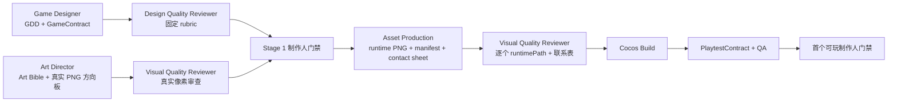

# 21. 独立质量审查与多模态美术架构

## 1. 目标

Artifact Ledger、严格契约和 provenance 只能证明“这份产物是谁在何时基于哪些输入写出的，当前字节是否仍一致”，不能证明玩法成立、视觉方向专业或美术资产可用。

质量链因此拆成三层：

1. 确定性校验：结构、引用、哈希、版本、PNG 字节、运行路径和工具证据。
2. 独立专业审查：审查 Agent 使用固定 rubric，输出绑定目标版本与哈希的机器可验证收据。
3. 制作人门禁：只有当前审查收据为 `pass`，制作人才可以审批阶段；审查 Agent 没有门禁批准权。

## 2. 角色分离

| 角色 | 能做 | 不能做 |
| --- | --- | --- |
| Game Designer | 编写 GDD、GameContract | 审批自己的设计质量 |
| Design Quality Reviewer | 以资深移动游戏设计总监视角审查设计 | 修改 GDD/GameContract、降低 rubric、批准制作人门禁 |
| Art Director | 编写 Art Bible、生成真实视觉方向板 | 审批自己的视觉方向 |
| Asset Production | 通过图片模型生产 runtime PNG、联系表和 manifest | 把 SVG 占位图冒充完成资产 |
| Visual Quality Reviewer | 用视觉模型读取真实图片字节并审查 | 生成或修改被审图片、仅凭文字描述通过 |

审查者只能写自己登记的 `quality_review` 产物。工具授权在 `agent + task + artifact + path + access` 五个维度同时收紧。

## 3. 质量审查收据

`ArtifactQualityReview` 使用 `schemaVersion=1.0.0` 和 `kind=artifact_quality_review`。关键字段包括：

- `targets[]`：精确绑定 `artifactId/version/path/ledgerHash/sizeBytes`。
- `rubric`：绑定服务端固定的 rubric ID、版本和通过阈值。
- `criteria[]`：固定 criterion ID、标签和权重，逐项给出分数、状态与可定位证据。
- `scoreTotal`：由加权分严格重算。
- `verdict`：`pass`、`change_requested` 或 `blocked`。
- `modelTrace`：服务端写入 provider、model、invocation 和 prompt 版本。

服务端拒绝未知字段、过期 target、作者自审、伪造模型追踪、修改 criterion/权重、降低通过阈值和没有真实像素检查的视觉收据。

`change_requested` 是有效的审查完成状态，但不是门禁通过状态。系统会把被审产物标记为 `change_requested`，重开当前阶段的作者任务，并发送带验收标准的变更请求。

## 4. 固定 Rubric

### Stage 1 设计质量

- 核心循环与玩家价值：25%。
- GDD 与 GameContract 一致性：20%。
- 节奏与数值依据：15%。
- MVP 范围与实现可行性：15%。
- 移动端可用性与可访问性：10%。
- 可测试性与可观测性：15%。

### Stage 1 视觉方向

- 视觉主张一致性：25%。
- 轮廓、焦点与小屏可读性：20%。
- 色板与对比层级：15%。
- 移动 UI 可读性：15%。
- 生产与技术可行性：15%。
- 原创性与 IP 安全：10%。

### Stage 2 视觉资产

- Art Bible 一致性：20%。
- 运行资产小屏辨识：20%。
- UI 层级：15%。
- 透明通道与边缘完整性：15%。
- 性能与纹理预算：10%。
- 资产覆盖完整性：10%。
- 原创性与 IP 安全：10%。

三套 rubric 的通过阈值均为 85。`pass` 还要求所有 criterion 为 `pass`，且不存在 critical/major finding、critical/major risk、required change 或 blocking issue。

## 5. 阶段工作流



联系表只能帮助快速审查，不能充当唯一 runtime 资产。Stage 2 至少要有一个独立、登记到任务、由真实图片生成工具产生的 PNG；manifest 中每个 `runtimePath` 都必须映射到当前 verified 产物，并被视觉检查的 path/hash/size 收据覆盖。

## 6. 多模态媒体平面

文本 Agent 仍负责规划、约束和收据编写；图片生成和像素检查通过独立、受控的媒体工具执行：

- `generate_raster_asset`：调用 DashScope 图片模型，立即下载临时结果并写成项目内 PNG。
- `inspect_visual_assets`：把任务授权的本地 PNG/JPEG/WebP 作为真实 data URL 传给视觉模型，返回结构化观察结果。

默认模型：

- 图片生成：`wan2.7-image-pro`，优先满足同一项目中的风格和角色一致性。
- 视觉检查：`qwen3.8-max`，支持真实图片输入与结构化 JSON 输出；可用环境变量切换为成本更低的模型。

可通过环境变量覆盖：

```text
BTP_IMAGE_GENERATION_MODEL=wan2.7-image-pro
BTP_VISION_REVIEW_MODEL=qwen3.8-max
BTP_IMAGE_GENERATION_ENDPOINT=https://dashscope.aliyuncs.com/api/v1/services/aigc/multimodal-generation/generation
BTP_VISION_REVIEW_ENDPOINT=https://dashscope.aliyuncs.com/compatible-mode/v1/chat/completions
```

API key 复用 Model Settings 中受保护的 DashScope provider 配置，不进入项目仓库、prompt、operation log 或模型上下文。

## 7. 生成证据与失败策略

每张真实生成图片记录：

- provider、model、request ID。
- prompt/negative prompt hash，不保存密钥。
- seed、宽高、MIME。
- endpoint fingerprint、耗时。
- 本地文件 hash、size 和 task input provenance。
- `mediaReviewStatus=pending_independent_review`。

供应商返回的下载 URL 不进入长期产物。系统只允许 Alibaba OSS/CDN 域名，立即下载并校验 PNG signature、IHDR、尺寸和最大字节数。429/5xx 做有限重试；4xx、安全审核失败、非法响应和伪 PNG 立即失败，不写入产物。

视觉检查记录每个输入图片的 `path/hash/size`。图片在审查后被替换、删除或修改时，收据立即过期。服务端还会把当前 Art Bible 注入权威上下文；Stage 2 额外注入当前 Manifest 摘要及每张 runtime PNG 的 hash、尺寸和 Alpha 技术事实。调用方的 `rubricPrompt` 只能补充观察重点，不能覆盖这份上下文。收据绑定 `authoritativeContextHash/requestSemanticHash`，因此 Art Bible、Manifest 或运行资产变化都会使旧审查过期。

视觉模型必须直接返回与服务端固定 rubric 同构的逐项分数、状态、finding 和 verdict；多批检查必须共享同一语义请求哈希，并按最低分和最严重状态保守合并。最终 `quality_review` 必须与该语义结果及 `responseHash/semanticHash` 完全一致，不能丢弃模型发现后另写 100 分通过。

图片生成 metadata 只有在同时绑定当前 Artifact Ledger、当前服务端 materialization operation 和当前文件 hash/size 时才可消费。普通写入、SVG 重渲染或后处理会清除旧媒体/视觉/Bridge 收据；旧快照中没有可信服务端 operation 链的历史自述会被迁移为 `change_requested`，不会被自动升级为真实生成证据。

## 8. Alpha 与 Cocos 消费真实性

Asset Manifest v2 使用 `schemaVersion=2.0.0`，每个运行资产必须显式声明：

- `alphaPolicy=required`：必须存在透明像素，同时不能整张全透明。
- `alphaPolicy=opaque`：任何透明或半透明像素都会失败。
- `alphaPolicy=optional`：只用于没有透明契约的资产，不能规避已知精灵需求。

系统会校验 PNG chunk CRC，解压 IDAT，处理 PNG filters、Adam7、各合法色型/bit depth 和 `tRNS`，按真实像素计算透明比例；legacy manifest 可读取以便迁移，但不能通过 Stage 2。

`cocos_import_assets` 会原子写入当前导入收据，绑定原始 manifest 和每个 `runtimePath → assets/resources/btp-art` 的 path/hash/size。`cocos_build` 在启动 Creator 前复验该收据、源图片和导入目标，并把收据摘要冻结进 build report。换图未重导入、导入目标被改动或后续重新导入，都会使旧 build 失效。

## 9. 当前边界

- 图片模型不承诺直接产出透明 sprite；现在会机器拒绝不满足 `alphaPolicy` 的文件，但高质量背景移除、发丝/半透明边缘修复仍需要专用后处理能力或人工美术。
- 视觉模型提供专业辅助判断，但不能替代制作人对品牌、审美和商业方向的决定。
- 本地版本使用单进程 evidence transaction；生产部署仍应把不可变收据和幂等媒体请求写入事务型数据库。
- 媒体生成会产生费用。重复相同已验证输出会复用本地产物；生产环境还应配置项目级预算、并发和每日上限。
